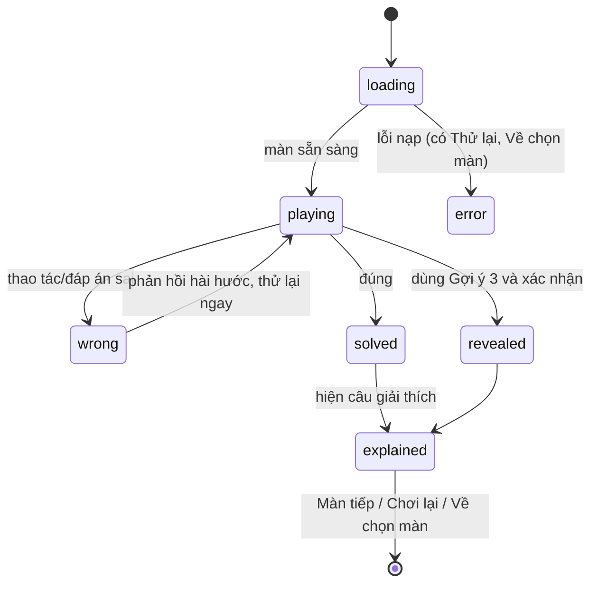

# GDD — Lắt Léo (tài liệu thiết kế game)

> **Trạng thái:** NHÁP v0.1, chờ chủ dự án duyệt · **Ngày soạn:** 2026-11-13 · **Soạn:** Claude, theo bản yêu cầu chủ dự án dán ngày 13/11/2026.
> **Quy tắc:** không sửa file này khi chưa hỏi chủ dự án. Danh sách màn: [LEVELS.md](LEVELS.md). Kỹ thuật: [TECH.md](TECH.md).
> Chỗ nào ghi **[GIẢ ĐỊNH Gx]** là điều tôi tự quyết khi bản yêu cầu chưa nói rõ; danh sách đầy đủ để duyệt nằm ở cuối bản trả lời bàn giao và được nhắc lại ở mục 13.

## 1. Tầm nhìn

**Lắt Léo** là game đố mẹo hack não kiểu Việt chơi trên trình duyệt điện thoại: mở link là chơi, không cài đặt, không đăng nhập, chơi một mình. Mỗi màn là một câu đố mẹo có tương tác; đáp án gần như không bao giờ nằm ở chỗ người chơi nghĩ đầu tiên.

**Bốn trụ cột**

| Trụ cột | Nghĩa là | Kiểm tra khi thiết kế màn |
|---|---|---|
| Mở link là chơi | Vào màn đầu trong vài giây, không đăng ký, không màn hướng dẫn dài | Người lạ chạm được vào màn 1 trong ≤ 3 giây sau khi trang tải xong |
| Lắt léo nhưng công bằng | Đáp án suy ra được từ đề và cảnh; "ồ, ra thế!" chứ không phải "ai mà biết" | Có ít nhất một manh mối nhìn thấy được cho mỗi mẹo |
| Rất Việt | Chợ, Tết, quán cà phê, kẹt xe, nhà ống; chơi chữ, nói lái, đố mẹo dân gian | Mỗi màn gắn với một bối cảnh hoặc lối chơi chữ Việt, không dịch từ nơi khác |
| Ngắn, hài, muốn chơi tiếp | Mỗi màn 30 giây đến vài phút; sai thì bị trêu nhẹ, không bị phạt | Câu giải thích sau màn làm người chơi cười hoặc "à" |

**Đối tượng:** từ 12 tuổi trở lên; nội dung phù hợp mọi lứa tuổi; giọng điệu hài hước, lầy nhẹ **[GIẢ ĐỊNH G1: nhóm 12–14 tuổi vào bản thử làm đổi đối tượng 15–35 trong docs/backlog.md và kéo theo câu hỏi pháp lý về dữ liệu trẻ vị thành niên, xem mục 9]**.

**Nền tảng:** trình duyệt di động (Chrome Android, Safari iOS) ở màn hình dọc, thiết kế từ chiều rộng 360 px; máy tính dùng được nhưng không phải mục tiêu chính.

**Nguyên tắc gốc rễ:** không sao chép màn chơi của bất kỳ game nào khác. Câu đố dân gian (ví dụ "Con gì càng to càng nhỏ?") được dùng như chất liệu chung của văn hóa, nhưng cách tương tác và cách trình bày phải là của riêng Lắt Léo.

## 2. Phạm vi bản chơi thử (MVP)

| Có trong MVP | Không làm trong MVP |
|---|---|
| 25 màn: 20 màn 2D + 5 màn 3D, độ khó tăng dần, 10 màn đầu dễ | Tài khoản, đăng nhập |
| Gợi ý 3 cấp mỗi màn (mơ hồ → rõ → xem đáp án) | Thanh toán, mua bán trong game |
| Một câu giải thích hài hước sau mỗi màn | Quảng cáo |
| Lưu tiến trình trên máy người chơi | Nhiều người chơi, phòng chơi, bảng xếp hạng |
| Đố mẹo mỗi ngày: một màn đặc biệt mỗi ngày | Ứng dụng tải về (App Store, Google Play) |
| Thẻ kết quả để chia sẻ, không lộ đáp án | Xưởng tự tạo màn |
| Ghi sự kiện đo lường (bắt đầu, giải xong, thời gian, gợi ý, bỏ cuộc) | |

Ngoài phạm vi MVP, chưa quyết có làm ở bước sau hay không: âm thanh và nhạc nền, màn hướng dẫn riêng, biểu mẫu phản hồi trong game. (Màn đầu tiên được thiết kế để tự dạy cách chơi, nên không cần màn hướng dẫn.)

## 3. Vòng chơi

### 3.1 Vòng trong một màn



Quy tắc cố định:
1. **Thử không giới hạn, không phạt.** Sai chỉ có phản hồi, không trừ gì.
2. **Mọi thao tác sai đều có phản hồi** (không bao giờ im lặng). Màn có thể khai báo phản hồi riêng cho lỗi điển hình; không thì dùng câu chung (mục 10.3).
3. **Ba nút luôn có mặt** trong lúc chơi: Gợi ý, Chơi lại, Về chọn màn. Màn 3D có thêm **Về góc ban đầu**.
4. Đúng ⇒ trong ≤ 1 giây hiện trạng thái thắng, rồi câu giải thích, rồi nút **Màn tiếp**. Ở màn cuối nút này thành **Xem tổng kết**.
5. Thoát giữa chừng (Về chọn màn, đóng tab, bỏ trang) được ghi là **bỏ cuộc** nếu màn chưa giải.
6. Nếu người chơi 20 giây không có thao tác tiến triển, hoặc sai 3 lần liền, nút Gợi ý nhấp nháy nhẹ. Không có hộp thoại ép buộc.

### 3.2 Vòng chiến dịch (25 màn)

- **Mở khóa tuần tự [GIẢ ĐỊNH G2]:** màn n+1 mở khi màn n đã `solved` hoặc `revealed`. Vì luôn có Gợi ý 3 (xem đáp án) nên không ai bị kẹt. Màn đã mở được chơi lại tự do.
  *Lý do:* đường cong độ khó chỉ có nghĩa khi đi theo thứ tự, và số liệu bỏ cuộc theo màn sạch hơn. *Khác docs/backlog.md (LL-006 mặc định mở sẵn mọi màn, chờ Q7).*
- Cờ kỹ thuật `NEXT_PUBLIC_UNLOCK_ALL=1` mở hết màn cho người thử và kiểm thử (không hiện trong giao diện).
- Thời lượng mục tiêu mỗi màn (giả thuyết để kiểm chứng bằng số liệu thật): độ khó 1 ≈ 30 giây, 2 ≈ 1 phút, 3 ≈ 2 phút, 4 ≈ 3 phút, 5 ≈ 5 phút. Cả chiến dịch ≈ 45 phút đến 1 giờ nếu ít dùng gợi ý.

### 3.3 Vòng ngày

Mỗi ngày một màn đặc biệt (mục 7). Người chơi quay lại hằng ngày để giải màn mới và giữ chuỗi ngày liên tiếp.

## 4. Các màn hình

| # | Màn hình | Đường dẫn | Nội dung chính |
|---|---|---|---|
| 1 | Trang chủ | `/` | Tên game, nút **Chơi** (lần đầu) hoặc **Chơi tiếp** (đến màn chưa xong đầu tiên), thẻ **Đố mẹo hôm nay** (chưa giải / đã giải, chuỗi ngày), liên kết Thông tin |
| 2 | Chọn màn | `/levels` | Lưới 25 ô đánh số, 5 cột × 5 hàng ở 360 px; mỗi ô ≥ 44×44 px. Trạng thái ô: khóa, mở, đã giải, đã xem đáp án; màn 3D có biểu tượng khối. Ô khóa chỉ hiện số, không hiện tên (tránh lộ mẹo) |
| 3 | Màn chơi | `/play/[id]` (`id` như `2d-02`, `3d-01`) | Xem bố cục bên dưới |
| 4 | Hộp gợi ý | lớp phủ dưới (bottom sheet) trong màn chơi | Ba bước gợi ý, nút xác nhận xem đáp án |
| 5 | Kết quả và giải thích | lớp phủ sau khi giải | Dấu thắng, câu giải thích, thời gian, số gợi ý, nút Màn tiếp, Chia sẻ, Chơi lại |
| 6 | Đố mẹo mỗi ngày | `/daily` | Cùng khung màn chơi, có nhãn ngày và chuỗi ngày |
| 7 | Thông tin và cài đặt | `/about` | Cảm biến (xin lại quyền), giảm chuyển động, chất lượng đồ họa (Tự động/Thấp), dữ liệu đang lưu và nút **Xóa dữ liệu**, ghi công, phiên bản |
| 8 | Hoàn tất | `/done` | Chỉ vào được khi đủ 25 màn (hoặc xem đáp án đủ): lời cảm ơn, tổng thống kê, Chia sẻ, đường tới Đố mẹo mỗi ngày |
| 9 | Lỗi và dự phòng | `error.tsx`, banner | Lỗi nạp màn (Thử lại, Về chọn màn), mất mạng (banner, màn đã nạp vẫn chơi được), thiết bị không có WebGL (xem TECH.md mục 8) |

**Bố cục màn chơi ở 360×640 px** (dọc là mặc định; xoay ngang không được làm mất trạng thái màn):

```text
┌──────────────────────────┐
│ ←   Màn 7 / 25        ↻  │  thanh trên: về chọn màn · số màn · chơi lại
├──────────────────────────┤
│ Đề bài: tối đa 3 dòng,   │  chữ thật của DOM (≥ 16 px), không vẽ bằng SVG
│ tiếng Việt có dấu        │
├──────────────────────────┤
│                          │
│        SÂN CHƠI          │  2D: SVG, tỉ lệ cố định, co giãn vừa khung
│   (SVG 2D hoặc Canvas 3D)│  3D: R3F Canvas
│                          │
├──────────────────────────┤
│ 💡 Gợi ý (0/3)    [⟲ 3D] │  thanh dưới: gợi ý · về góc ban đầu (chỉ màn 3D)
└──────────────────────────┘
```

Vùng chạm của mọi nút ≥ 44×44 px; chừa vùng an toàn (safe-area) trên iPhone; ở màn có ô nhập chữ, sân chơi co lại khi bàn phím ảo mở thay vì bị che.

## 5. Hệ thống gợi ý

Ba cấp, mở **tuần tự** trong hộp gợi ý, không tốn tiền hay lượt:

| Cấp | Tên nút | Nội dung | Điều kiện mở | Ảnh hưởng tới kết quả |
|---|---|---|---|---|
| 1 | Gợi ý nhẹ | Mơ hồ: chỉ hướng nghĩ, **không** nói thao tác | Bấm bất kỳ lúc nào | Mức "Có gợi ý" |
| 2 | Gợi ý rõ | Nói rõ phải để ý cái gì hoặc làm kiểu gì, **chưa** nói đáp án | Sau khi đã mở cấp 1 | Mức "Có gợi ý" |
| 3 | Xem đáp án | Cách giải đầy đủ; màn có thể tô sáng chỗ cần thao tác | Sau cấp 2, kèm hộp xác nhận "Xem đáp án? Màn này sẽ không tính là tự giải" | Mức "Xem đáp án", trạng thái `revealed`, vẫn mở khóa màn kế |

Quy tắc:
- Số gợi ý của một lượt chơi = cấp cao nhất đã mở (0–3). Mở lại gợi ý đã xem không tính thêm.
- Mỗi gợi ý ≤ 120 ký tự, tăng dần mức tiết lộ (kiểm bằng rà soát hai người, mục 11).
- **Mức tự giải** của một màn (dùng cho thẻ chia sẻ và thống kê): *Tự giải* (0 gợi ý) · *Có gợi ý* (1–2) · *Xem đáp án* (3). Không có sao, điểm hay tiền tệ **[GIẢ ĐỊNH G3: tôi thêm ba mức này để thẻ kết quả có nội dung; nếu bạn không muốn xếp hạng người chơi thì chỉ giữ số gợi ý]**.
- Chơi lại một màn đã giải bắt đầu đếm gợi ý từ 0; kết quả tốt nhất được giữ.
- Mỗi lần mở gợi ý ghi sự kiện `hint_used` kèm cấp (mục 9).

## 6. Tiến trình và lưu trữ

Toàn bộ nằm **trên máy người chơi**, không có tài khoản, không đồng bộ giữa thiết bị.

| Dữ liệu | Nội dung | Ghi chú |
|---|---|---|
| Mã ẩn danh | Một mã ngẫu nhiên (UUID) tạo lần đầu mở game | Không gắn với tên, email hay thiết bị; chỉ dùng để nối các sự kiện đo lường của cùng một máy |
| Kết quả từng màn | `solved` hoặc `revealed`, thời gian tốt nhất, số gợi ý tốt nhất, lần giải gần nhất | Khóa theo mã màn ổn định (`2d-02`), không theo số thứ tự |
| Đố mẹo mỗi ngày | Kết quả theo ngày, chuỗi ngày hiện tại và dài nhất | Xem mục 7 |
| Cài đặt | Quyền cảm biến (chưa hỏi / cho phép / từ chối), giảm chuyển động, chất lượng đồ họa | Mục 12 |

Quy tắc:
- Đóng trình duyệt rồi mở lại vẫn thấy đủ tiến trình. Xóa dữ liệu trình duyệt thì mất tiến trình; trang **Thông tin** nói rõ điều này.
- Không lưu được (chế độ riêng tư, hết dung lượng): vẫn chơi bình thường, tiến trình giữ trong phiên và hiện một dòng báo "Tiến trình sẽ mất khi đóng tab", không chặn chơi.
- Dữ liệu hỏng hoặc phiên bản lạ: bỏ qua phần hỏng và bắt đầu lại phần đó, không bao giờ làm sập game.
- Nút **Xóa dữ liệu** trong Thông tin xóa sạch (kể cả mã ẩn danh) và cho một mã mới.
- Định dạng lưu có số phiên bản để nâng cấp về sau (chi tiết ở TECH.md mục 6).

## 7. Đố mẹo mỗi ngày

- **Một màn đặc biệt mỗi ngày, giống nhau với mọi người chơi trong cùng ngày**, chọn bằng một hàm xác định theo ngày (không cần máy chủ).
- **Ngày tính theo giờ Việt Nam (UTC+7)**, đổi ngày lúc 00:00 **[GIẢ ĐỊNH G4]**, để mọi người cùng thấy một câu và so kết quả được.
- **Kho riêng, tách khỏi 25 màn chiến dịch.** Câu ngày ngắn hơn (30–90 giây), dùng lại các cơ chế đã có (gõ chữ, chạm vật, chạm chữ, chọn đáp án, kéo đơn giản) và khai báo thành dữ liệu để thêm câu mới không phải viết thêm cảnh. Có đủ ba gợi ý và câu giải thích như màn thường.
- **Kho này chưa có nội dung.** Bản yêu cầu chỉ nêu 25 màn. Tôi đề xuất tối thiểu **14 câu** (hai tuần) cho bản thử, hết kho thì quay vòng và ghi rõ "câu từng gặp". Cần bạn quyết cách soạn (mục 13, câu hỏi H2).
- Luôn mở, không phụ thuộc tiến độ chiến dịch.
- **Chuỗi ngày:** số ngày liên tiếp có hoàn thành câu ngày (xem đáp án vẫn giữ chuỗi). Lỡ một ngày thì chuỗi về 0. Không chơi bù câu của ngày cũ trong MVP.
- Số thứ tự câu ngày = số ngày kể từ mốc phát hành + 1 (mốc nằm trong cấu hình), dùng làm "Đố mẹo #n" trên thẻ chia sẻ.
- Đồng hồ máy bị chỉnh sai thì chấp nhận (game một người, không chống gian lận).

## 8. Chia sẻ: thẻ kết quả

Mục tiêu: khoe kết quả, rủ bạn chơi, **không lộ đáp án**.

| Được phép có trên thẻ | Tuyệt đối không có |
|---|---|
| Tên game, nhãn "Màn 12/25" hoặc "Đố mẹo #n" | Đề bài, tên màn, nội dung màn |
| Mức tự giải (Tự giải, hoặc 💡 nhân số gợi ý) | Nội dung gợi ý và đáp án |
| Thời gian giải (mm:ss), chuỗi ngày (với câu ngày) | Câu giải thích, ảnh chụp cảnh chơi |
| Độ lắt léo bằng chấm (●●●○○) | Mã ẩn danh, bất kỳ dữ liệu định danh nào |
| Đường link game | |

- Thẻ là **ảnh vuông** vẽ ngay trên máy (canvas), kèm **đoạn chữ** dùng khi không gửi được ảnh. Ví dụ: `Lắt Léo · Màn 12/25 · Tự giải trong 0:48 · ●●●○○ — Thử xem bạn có lắt léo bằng mình không? <link>`.
- Gửi bằng chia sẻ của hệ điều hành khi có; nếu không có thì **Sao chép chữ** và **Tải ảnh**.
- Bộ dựng thẻ chỉ nhận một cấu trúc dữ liệu gồm đúng các trường được phép, nên về mặt kiểu dữ liệu không thể đưa đề bài hay đáp án vào thẻ (TECH.md mục 9) và có test chặn.
- Có ở: kết quả mỗi màn, kết quả câu ngày, màn Hoàn tất (thẻ tổng kết: số màn tự giải, tổng gợi ý, tổng thời gian).

## 9. Đo lường

Mục đích: biết màn nào quá dễ, quá khó, hay làm người chơi bỏ cuộc, để chỉnh độ khó sau bản thử. Không thu thông tin định danh.

### 9.1 Sự kiện

| Sự kiện | Phát khi | Trường riêng |
|---|---|---|
| `level_start` | Màn (chiến dịch hoặc câu ngày) bắt đầu cho thao tác | `levelId`, `mode` (`campaign`/`daily`), `attemptNo` (lần chơi thứ mấy của màn này trên máy), `restart` (true nếu bấm Chơi lại) |
| `hint_used` | Mở một cấp gợi ý lần đầu trong lượt chơi | `levelId`, `tier` (1–3), `elapsedMs` |
| `level_complete` | Giải xong hoặc xem đáp án xong | `levelId`, `mode`, `durationMs` (**thời gian**), `hintsUsed` (**số gợi ý**, 0–3), `result` (`solved`/`revealed`), `wrongCount` |
| `level_abandon` | Rời màn khi chưa giải: Về chọn màn, chuyển trang, đóng tab, nền quá 5 phút | `levelId`, `mode`, `durationMs`, `hintsUsed`, `wrongCount` |

Trường chung mọi sự kiện: `eventId` (UUID, để loại trùng), `installId`, `sessionId` (mỗi lần mở trang), `ts`, `appVersion`, `device` (loại: ios/android/desktop; kích thước màn; mức đồ họa đang dùng). **Không** ghi tên, email, IP thô, vị trí. **[GIẢ ĐỊNH G6: bản yêu cầu liệt kê "bắt đầu màn, giải xong, thời gian, số gợi ý, bỏ cuộc"; tôi gộp "thời gian" và "số gợi ý" vào `level_complete`/`level_abandon` và thêm `hint_used` để biết gợi ý nào dùng lúc nào.]**

### 9.2 Quy tắc
- `durationMs` chỉ tính lúc tab đang hiện; tạm dừng khi tab ẩn.
- Mọi màn đều phát `level_start` và sau đó **đúng một** trong `level_complete` hoặc `level_abandon` cho mỗi lượt chơi. Việc này do **khung chạy màn** đảm bảo, không để từng màn tự gọi, và có kiểm thử tự động (TECH.md mục 11).
- Gửi sự kiện thất bại **không bao giờ** ảnh hưởng việc chơi. Hàng đợi trên máy có giới hạn, gửi theo lô, loại trùng theo `eventId`; sự kiện lúc đóng tab chỉ là cố gắng tối đa.
- Nơi nhận sự kiện: endpoint của chính game, không dùng dịch vụ phân tích bên thứ ba **[GIẢ ĐỊNH G7]**; nơi lưu và thời gian giữ chưa chốt (H1, H3).

### 9.3 Giả thuyết độ khó để kiểm chứng bằng số liệu thật
Không phải yêu cầu; là mốc để biết thang độ khó 1–5 trong LEVELS.md có đúng không.

| Độ khó | Giải xong không dùng gợi ý | Thời gian giải trung vị |
|---|---|---|
| 1 | ≥ 85% | ≤ 30 giây |
| 2 | ≥ 70% | ≤ 1 phút |
| 3 | ≥ 50% | ≤ 2 phút |
| 4 | ≥ 35% | ≤ 3 phút |
| 5 | ≥ 20% | ≤ 5 phút |

Màn lệch nhiều so với mốc thì chỉnh độ khó, câu chữ gợi ý hoặc vị trí trong dãy.

## 10. Giọng điệu

### 10.1 Cách nói
- Như một người bạn lầy nhẹ: trêu bạn chứ không chê bạn. Game gọi người chơi là "bạn" và tự xưng "mình".
- Câu ngắn, tiếng Việt đời thường, có dấu đầy đủ và đúng. Tránh phương ngữ quá hẹp ngoài những chỗ chơi chữ cần đến.
- Hài hước từ tình huống quen thuộc (Tết, kẹt xe, lời hứa "năm phút nữa tới"), không từ việc làm người chơi thấy mình dở.
- **Không** chửi thề, nói tục, chuyện chính trị, tôn giáo, kỳ thị vùng miền, ngoại hình, giới, dân tộc. Nội dung phù hợp từ 12 tuổi.

### 10.2 Giới hạn độ dài
Đề bài ≤ 3 dòng ở 360 px (khoảng 120 ký tự) · mỗi gợi ý ≤ 120 ký tự · phản hồi sai ≤ 60 ký tự · câu giải thích ≤ 140 ký tự.

### 10.3 Mẫu câu

| Tình huống | Ví dụ |
|---|---|
| Sai (chung) | "Chưa phải đâu. Thử nghĩ khác cái đầu tiên bạn nghĩ nha." · "Gần rồi! Nhưng 'gần' chưa phải 'đúng'." |
| Sai lần thứ 3 | "Bí rồi hả? Nút 💡 đang nhấp nháy kìa." |
| Mở gợi ý 1 | "Gợi ý nhẹ thôi, đừng giận mình nha." |
| Đúng | "Chuẩn!" · "Lắt léo thật, nhưng bạn lắt léo hơn." |
| Xem đáp án | "Không sao, mẹo hay thì ai cũng cần biết một lần." |
| Chuỗi ngày | "3 ngày liền! Hình như bạn có duyên với mẹo." |
| Hoàn tất | "Bạn đã qua hết 25 màn lắt léo. Mai có đố mẹo mới nha." |

## 11. Nguyên tắc thiết kế màn

Mọi màn mới hoặc sửa màn phải qua danh sách này. Các quy tắc có thể kiểm bằng máy (3, 11, 12) được kiểm tự động trên danh sách màn.

1. **Một mẹo, một "À!".** Mỗi màn chỉ có một ý tưởng lệch hướng, không chồng hai mẹo.
2. **Công bằng.** Có manh mối nhìn hoặc đọc thấy được (dù mơ hồ). Không dò từng điểm ảnh, không đoán mò: màn chỉ dựa vào chọn đáp án phải có ≥ 4 lựa chọn hoặc thêm một bước thao tác.
3. **Phản ứng đầu tiên sai, phản ứng thứ hai đúng.** Cách làm hiển nhiên dẫn tới thất bại hài hước; đáp án thật suy ra được.
4. **Đề ngắn.** ≤ 3 dòng ở 360 px (khoảng 120 ký tự), là chữ thật của trang (không vẽ trong SVG), chữ ≥ 16 px.
5. **Giải được chỉ bằng thao tác chạm.** Thao tác dùng cảm biến luôn có cách thay thế bằng chạm. Không cần chuột phải, rê chuột, phím tắt.
6. **Không dựa vào màu đơn thuần** (người mù màu): luôn có thêm hình dạng hoặc chữ.
7. **Không chạy đua thời gian**, trừ khi chính việc chờ là mẹo.
8. **Sai nào cũng có phản hồi.** Mỗi màn khai báo ít nhất 2 lỗi điển hình kèm phản hồi riêng.
9. **Ba gợi ý tăng dần:** cấp 1 không nói thao tác, cấp 2 không nói đáp án, cấp 3 nói hết.
10. **Câu giải thích** một câu, ≤ 140 ký tự, hài, nói rõ mẹo là gì.
11. **Không lặp một kiểu quá 2 màn liền**, tính riêng cho "kiểu tư duy" (chơi chữ, đọc kỹ đề, thị giác, vật lý, logic) và cho "thao tác chính" (gõ, chạm, kéo, lắc, nhấn giữ, chờ, chọn, xoay).
12. **Đường cong độ khó** theo thang dưới đây: 10 màn đầu ≤ 2; độ khó trung bình của mỗi nhóm 5 màn liên tiếp không thấp hơn nhóm trước; màn 3D đầu tiên ≤ 2 và có chỉ dẫn xoay.
13. **Nguyên bản.** Không sao chép màn của game khác. Câu đố dân gian ghi nguồn "dân gian". Màn chơi chữ phải được hai người khác tác giả đọc soát (dấu thanh, nói lái, cách viết).
14. **Màn 3D:** luôn có "Về góc ban đầu", camera có giới hạn, vùng chạm ≥ 44 px bằng hộp chạm ẩn lớn hơn vật.

**Thang độ khó**

| Mức | Ý nghĩa |
|---|---|
| 1 | Gần như ai cũng ra trong ≤ 30 giây, không cần gợi ý |
| 2 | Phải nghĩ một nhịp; vài người cần gợi ý 1 |
| 3 | Phải đổi hướng nghĩ; nhiều người cần gợi ý 1 |
| 4 | Cần gợi ý 1–2 mới ra với phần lớn người chơi |
| 5 | Nhiều người sẽ phải xem đáp án; ra được thì rất đã |

## 12. Cảm biến và khả năng truy cập

### 12.1 Cảm biến
- Chỉ **một** màn dùng cảm biến ở bản thử: lắc máy ở màn Hái xoài (2D-04). Nghiêng máy được hỗ trợ ở tầng kỹ thuật nhưng chưa màn nào bắt buộc **[GIẢ ĐỊNH G10]**.
- Cách thay thế bằng chạm nằm ngay trong cảnh (chạm liên tục hoặc vuốt qua lại thân cây), không phải một nút "bỏ qua" làm lộ mẹo.
- **iPhone:** xin quyền cảm biến **một lần, ở lần đầu bấm Chơi** (đó là một cử chỉ của người dùng, hệ điều hành yêu cầu vậy), bằng hộp giải thích của game rồi mới gọi hộp hỏi của hệ điều hành. Lời giải thích **không nêu màn nào hay thao tác nào** để không lộ mẹo, ví dụ: "Một vài màn dùng cảm biến chuyển động của máy. Cho phép để chơi trọn vẹn, hoặc bỏ qua: bạn vẫn chơi được bằng cách chạm." **[GIẢ ĐỊNH G11]**
- Từ chối hoặc thiết bị không có cảm biến (máy tính, máy cũ): dùng cách chạm, không hỏi lại liên tục. Trang Thông tin có nút xin lại quyền; nếu hệ điều hành chặn thì hướng dẫn người chơi mở lại trong cài đặt trình duyệt.
- Cần kết nối HTTPS để cảm biến hoạt động trên trình duyệt di động.

### 12.2 Khả năng truy cập
- Chữ đề bài ≥ 16 px, tương phản chữ/nền ≥ 4,5:1; vùng chạm ≥ 44×44 px.
- Tôn trọng `prefers-reduced-motion`: bớt rung, nhấp nháy, chuyển cảnh; hiệu ứng "rung lắc" thành thay đổi tĩnh.
- Trang đặt `lang="vi"`; điều hướng chính (chọn màn, nút gợi ý, kết quả) dùng được bằng bàn phím trên máy tính.
- **Đọc màn hình đầy đủ không nằm trong MVP** vì câu đố mang tính thị giác; ghi ra để không hứa quá.

## 13. Giả định và câu hỏi mở

Đây là chỗ tôi tự quyết khi bản yêu cầu chưa nói. Mỗi mục có mã để tài liệu khác dẫn tới. Sau khi bạn duyệt, ghi quyết định vào `scrum/HO_SO.md` (nhật ký quyết định) thay vì sửa lại mục này.

### 13.1 Giả định

| Mã | Giả định | Ở đâu |
|---|---|---|
| G1 | Đối tượng từ 12 tuổi (docs/backlog.md ghi 15–35); kéo theo câu hỏi pháp lý dữ liệu trẻ vị thành niên | GDD 1, 9 |
| G2 | Mở khóa tuần tự, xem đáp án vẫn mở màn kế; có cờ mở hết cho người thử | GDD 3.2 |
| G3 | Ba mức tự giải (Tự giải / Có gợi ý / Xem đáp án), không có sao hay điểm | GDD 5 |
| G4 | "Ngày" của câu mỗi ngày tính theo giờ Việt Nam (UTC+7) | GDD 7 |
| G5 | Câu mỗi ngày lấy từ kho riêng, tối thiểu 14 câu; kho này chưa có nội dung | GDD 7 |
| G6 | Tập sự kiện đo lường gồm 4 sự kiện (thêm `hint_used`, gộp thời gian và số gợi ý vào kết quả) | GDD 9 |
| G7 | Sự kiện gửi về endpoint của chính game, không dịch vụ bên thứ ba; mã ẩn danh sinh trên máy | GDD 9, TECH 9 |
| G8 | Chấm đáp án ngay trên trình duyệt; đáp án nằm trong mã tải về (chấp nhận vì game một người, chơi được khi mất mạng) | TECH 5 |
| G9 | Gõ chữ bằng bàn phím ảo của điện thoại tính là "thao tác chạm"; đáp án gõ bỏ qua hoa/thường, dấu, khoảng trắng thừa và chấp nhận nhiều biến thể | LEVELS, TECH 7 |
| G10 | Chỉ 1 màn dùng cảm biến (lắc), có cách chạm thay; không màn nào bắt buộc nghiêng | GDD 12 |
| G11 | Xin quyền cảm biến trên iPhone ở lần đầu bấm Chơi, lời giải thích không lộ mẹo | GDD 12 |
| G12 | Năm màn 3D nằm ở vị trí 8, 13, 17, 21, 25 | LEVELS |
| G13 | Độ khó 1–5, 10 màn đầu ≤ 2, trung bình mỗi nhóm 5 màn không giảm | GDD 11, LEVELS |
| G14 | Cách tôi hiểu 10 ý tưởng bạn đưa, nhất là các điểm mơ hồ (xem LEVELS.md mục 3) | LEVELS 3 |
| G15 | Câu đố dân gian và kinh điển (đàn vịt, gà trống, chia trâu, túi nhãn nhầm, cân bánh...) là chất liệu chung; cần rà nguyên bản và nguồn trước khi phát hành | LEVELS |
| G16 | Trong ngân sách hiệu năng chỉ có "mở game < 3 giây trên 4G" và "mỗi màn 3D tải thêm < 1 MB" là yêu cầu của bạn; các con số khác là đề xuất khởi điểm chờ đo | TECH 10 |
| G17 | Chưa ghim phiên bản R3F, drei, Zustand, Vitest, Playwright; chọn khi cài và ghi bằng chứng | TECH 2 |
| G18 | TECH.md thay phần kiến trúc, cấu trúc thư mục và bỏ PostgreSQL của docs/ai-planning/ARCHITECTURE.md | TECH 3, 4 |

### 13.2 Câu hỏi mở (cần bạn trả lời, mỗi câu có gợi ý)

| Mã | Câu hỏi | Gợi ý của tôi |
|---|---|---|
| H1 | Chạy ở đâu (hosting) và sự kiện đo lường lưu ở đâu? | Chạy Next.js trên một dịch vụ có hàm máy chủ miễn phí; lưu sự kiện vào một bảng đơn giản; chốt trước khi dựng `level_*` |
| H2 | Ai soạn kho câu mỗi ngày và bao nhiêu câu? | Tôi soạn 14 câu ở bước sau để bạn duyệt |
| H3 | Dữ liệu ẩn danh của người chơi 12–17 tuổi: giữ bao lâu, ai được xem, có cần thông báo hay xin phép phụ huynh không? | Không thu gì ngoài sự kiện ẩn danh ở mục 9, giữ 90 ngày; cần bạn hoặc người hiểu pháp lý xác nhận |
| H4 | "Android tầm thấp" cụ thể là máy nào để đo? | Một máy RAM 3–4 GB bạn đang có; nếu chưa có thì giả lập giảm CPU 4× và ghi rõ "chưa đo máy thật" |
| H5 | Phong cách hình ảnh và phông chữ? | Màu tươi, hình khối phẳng; phông có bộ chữ tiếng Việt (ví dụ Be Vietnam Pro hoặc Nunito), chốt khi dựng giao diện |

### 13.3 Điểm lệch với tài liệu đã có

Bản yêu cầu mới thắng khi mâu thuẫn (thứ tự ưu tiên nguồn ở docs/ai-planning/REQUIREMENTS.md: yêu cầu trực tiếp của chủ dự án đứng đầu). Backlog và kế hoạch AI **chưa được cập nhật** theo các điểm dưới; chạy `/docmoi` để đối soát.

| # | Tài liệu cũ nói | Bản này |
|---|---|---|
| 1 | Người chơi 15–35 tuổi | Từ 12 tuổi (G1) |
| 2 | PostgreSQL lưu tiến độ và sự kiện (LL-002, LL-003, LL-007, LL-049) | Tiến trình lưu trên máy; sự kiện về endpoint của game, nơi lưu chưa chốt (G7, H1) |
| 3 | Three.js trực tiếp (LL-014 và các story 3D) | React Three Fiber + drei |
| 4 | "Không thêm global state library" (ai-planning/ARCHITECTURE.md) | Zustand |
| 5 | Gợi ý, chia sẻ kết quả, kiểm thử tự động nằm ở "Đề xuất thêm, ngoài phạm vi" | Gợi ý, chia sẻ, kiểm thử tự động nằm trong MVP; màn hướng dẫn, âm thanh, biểu mẫu phản hồi vẫn ngoài |
| 6 | Không có câu giải thích sau màn, không có đố mẹo mỗi ngày | Có cả hai |
| 7 | Mô hình glTF do họa sĩ 3D làm, có trình nạp và ngân sách (LL-016, 034, 035, 045–047) | 3D dựng từ hình khối cơ bản trong code, chưa dùng file mô hình ngoài |
| 8 | Độ khó thang 1–3 (LL-028) | Thang 1–5 |
| 9 | Mọi màn mở sẵn (LL-006, chờ Q7) | Mở tuần tự (G2) |
| 10 | LL-049 có 5 sự kiện: mở màn, thắng, sai, thoát giữa chừng, lỗi | 4 sự kiện (G6) |
| 11 | Q8 (chấm đáp án ở client hay server) còn mở | Chấm ở client (G8) |
| 12 | Ngân sách 3D là `docs/performance/3d-budget.json` do LL-016-T01 tạo | TECH.md mục 10; sau khi duyệt chọn một nơi làm nguồn duy nhất |

