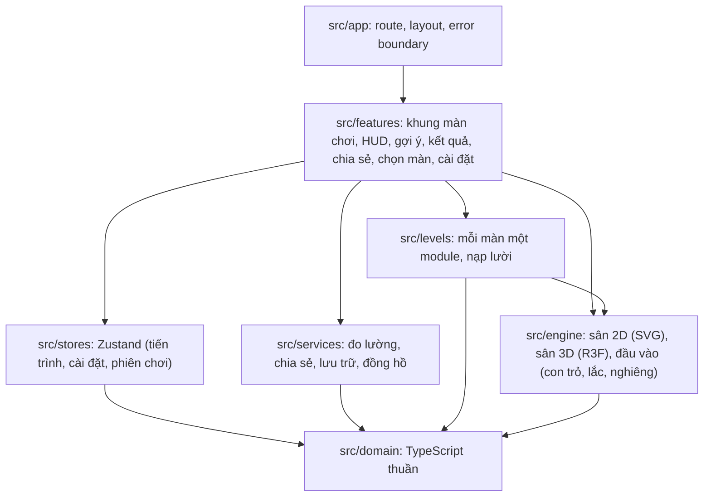

# TECH — Kiến trúc kỹ thuật của Lắt Léo

> **Trạng thái:** NHÁP v0.1, chờ chủ dự án duyệt · **Ngày soạn:** 2026-11-13 · **Soạn:** Claude. Thiết kế game: [GDD.md](GDD.md); danh sách màn: [LEVELS.md](LEVELS.md).
> Mã giả và mã ví dụ trong file này là **thiết kế**, chưa tồn tại trong repo. Chỗ nào ghi "đã có" là điều tôi đã xác minh trong repo ngày 2026-11-13. Mã **[GIẢ ĐỊNH Gx]** trỏ tới GDD mục 13.
> File này **thay** phần kiến trúc, cấu trúc thư mục và bỏ PostgreSQL của `docs/ai-planning/ARCHITECTURE.md` **[G18]**; backlog và kế hoạch AI chưa được cập nhật theo, xem GDD mục 13.3.
> **Cập nhật 2026-11-14:** khung nền tảng (epic Nền tảng) đã dựng theo file này. Các chỗ mã khác thiết kế đã được sửa ngay ở mục 2, 4, 5.1–5.3, 6, 9.1 và 11; bằng chứng ở [evidence/E1-NEN-TANG.md](evidence/E1-NEN-TANG.md).

## 1. Phạm vi và nguyên tắc

Lắt Léo là ứng dụng web chạy chủ yếu **trong trình duyệt**. Máy chủ chỉ phục vụ trang và (tùy chọn) nhận lô sự kiện đo lường ở `/api/events`; không có cơ sở dữ liệu, không có tài khoản.

1. **Phía trình duyệt là chính.** Tiến trình, chấm đáp án, chọn câu mỗi ngày đều chạy trên máy người chơi; màn đã nạp chơi được khi mất mạng **[G8]**.
2. **Miền (domain) thuần.** Luật chơi, so khớp đáp án, gợi ý, chọn câu ngày, dựng thẻ chia sẻ viết bằng TypeScript thuần, không React, không trình duyệt, để kiểm thử nhanh và chắc.
3. **Mỗi màn là một module độc lập, nạp lười.** Danh sách màn chỉ nạp siêu dữ liệu; cảnh của màn nạp khi vào màn. Mã 3D tách riêng, màn 2D không bao giờ tải three.js.
4. **Không thêm thư viện** ngoài danh sách ở mục 2 khi chưa có lý do ghi lại.
5. **Mọi thao tác có đường chạm**; cảm biến luôn có cách thay.
6. **Không sập:** mỗi màn có error boundary riêng; lỗi một màn không kéo theo màn khác.
7. **Hiệu năng là ràng buộc cứng** (mục 10), kiểm bằng số đo chứ không bằng cảm giác.

## 2. Công nghệ

| Hạng mục | Lựa chọn | Tình trạng |
|---|---|---|
| Runtime | Node 22.22.3 (`.nvmrc`; `engines` `>=22.22.3 <23`), npm 10.9.8 | **Đã có** |
| Khung web | Next.js 16.4.6, App Router, thư mục `src/app` | **Đã có** |
| UI | React 19.3.1 | **Đã có** |
| Ngôn ngữ | TypeScript 5.9.3, `strict: true`, bí danh `@/*` trỏ tới `src/*` | **Đã có** |
| Kiểm tra mã | ESLint 10.14.0 + eslint-config-next 16.4.6 (`--max-warnings 0`); Prettier 3.10.0, nháy đơn | **Đã có** |
| 3D | `three` (+ `@types/three`), `@react-three/fiber` (R3F), `@react-three/drei` | **Đã cài**: three 0.187.0, @types/three 0.187.0, @react-three/fiber 9.8.2, @react-three/drei 10.7.9. Chưa có màn nào dùng; không lọt vào gói của trang 2D |
| Trạng thái | Zustand | **Đã có**: zustand 5.1.0 |
| Kiểm thử | Vitest (+ Testing Library, môi trường DOM giả), Playwright (`@playwright/test`) | **Đã có**: vitest 5.1.0 (+ vite 8.3.8, jsdom 31.0.0, @testing-library/dom 10.4.2, react 16.3.3, jest-dom 7.0.1, user-event 14.6.8), @playwright/test 1.65.0 |
| Kiểu dáng | CSS Modules + biến CSS (design token) trong `src/styles/tokens.css`, không thêm thư viện CSS | Đề xuất |
| Phông | Phông tự host có bộ chữ tiếng Việt qua `next/font` (ứng viên: Be Vietnam Pro, Nunito) | Chờ H5 |
| 2D | SVG viết bằng JSX, không canvas, không thư viện đồ họa | Theo yêu cầu |
| 3D (hình) | Low-poly dựng từ hình khối cơ bản trong code, **không** file mô hình ngoài | Theo yêu cầu |

Ghi chú khi cài **[G17]**:
- Repo đang **ghim phiên bản chính xác** cho mọi gói; giữ cách đó. Phiên bản các gói mới cài (bảng trên) được chọn ngày 2026-11-14 sau khi kiểm `peerDependencies` với React 19.3.1; bằng chứng ở `docs/evidence/E1-NEN-TANG.md`. Gói nào cài thêm sau này cũng làm như vậy.
- Vì React là 19.x, R3F phải là dòng hỗ trợ React 19 (v9 trở lên), drei là bản tương ứng với R3F đã chọn. **R3F 9.8.2 chỉ chấp nhận React `>=19 <19.4`**: nâng React tới 19.4 thì phải nâng R3F trước (kiểm `npm view @react-three/fiber peerDependencies`). Dùng import có tên (`import { Mesh } from 'three'`) để tree-shaking.
- Không dùng engine vật lý, không dùng thư viện cử chỉ (kéo-thả viết bằng Pointer Events, mục 7), không dùng thư viện hoạt ảnh nặng. Cần thì ghi lý do rồi mới thêm.

## 3. Kiến trúc



Quy tắc phụ thuộc (mũi tên = được phép `import`; ngoài đó là cấm):
- `domain` không import gì ngoài TypeScript.
- `engine` và `levels` **không** import `features`; màn chỉ nói chuyện với khung chơi qua `LevelSession` được truyền vào (mục 5).
- Cấm này kiểm bằng ESLint `no-restricted-imports` theo thư mục (việc cần làm khi dựng khung).

**Ranh giới máy chủ/trình duyệt**
- Trang tĩnh (`layout`, Thông tin) là Server Component. Mọi thứ cần trạng thái, sự kiện con trỏ, `localStorage`, WebGL là Client Component (`'use client'`).
- `<Canvas>` của R3F chỉ được nhập từ Client Component qua `next/dynamic` với `ssr: false` (Next không cho `ssr: false` trong Server Component).
- `error.tsx` bắt lỗi theo tuyến; thêm error boundary riêng quanh cảnh của từng màn để có nút Chơi lại / Về chọn màn mà không rời trang.

**Luồng vào một màn:** `/play/[id]` (Server) kiểm `id` hợp lệ, trang "không tìm thấy màn" nếu sai → `GameShell` (Client) lấy siêu dữ liệu từ danh sách màn, kiểm mở khóa → nạp lười `scene` của màn → tạo `LevelSession` (gắn đo lường, gợi ý, bộ đếm thời gian) → hiển thị `Scene`.

## 4. Cấu trúc thư mục

Từ 2026-11-14 repo có khung nền tảng: trang chủ, chọn màn, màn chơi, kết quả, trang đố mẹo mỗi ngày (hiện báo chưa có câu), trang lỗi/404; domain (màn, gợi ý, tiến trình), sân 2D và cảnh `ChooseScene`, khung chạy màn, lưu tiến trình, đo lường, và hai **màn mẫu** `2d-sample-01/02` (xóa khi dựng 25 màn thật). Thư mục chỉ có `.gitkeep` và file còn ghi trong cây dưới mà chưa có (`about`, `done`, `api/events`, `domain/answers`, `domain/daily`, `engine/input`, `engine/stage3d`, `features/settings`, `features/share`, `services/share`, `levels/daily`, `stores/settings.ts`) là **chỗ chờ**, sẽ dựng cùng story tương ứng.

```text
game-guess/
├── CLAUDE.md                 chỉ dẫn cho Claude
├── docs/                     GDD.md, LEVELS.md, TECH.md · backlog.md, sprint-1.md (chỉ đọc) · ai-planning/ · evidence/
├── scrum/                    HO_SO.md, BACKLOG.md, SPRINT.md, LICH_SU.md
├── src/
│   ├── app/                  (đã có layout.tsx, page.tsx)
│   │   ├── levels/page.tsx           chọn màn
│   │   ├── play/[id]/                page.tsx, error.tsx, not-found.tsx
│   │   ├── daily/page.tsx            đố mẹo mỗi ngày
│   │   ├── about/page.tsx            thông tin, cài đặt, dữ liệu
│   │   ├── done/page.tsx             hoàn tất
│   │   ├── api/events/route.ts       nhận lô sự kiện (tùy chọn, chờ H1)
│   │   └── error.tsx, global-error.tsx
│   ├── domain/               TypeScript thuần, không React
│   │   ├── levels/                   types.ts, validate.ts (bất biến của danh sách màn)
│   │   ├── answers/                  normalize.ts, parse-clock.ts, match.ts
│   │   ├── hints/                    hint-machine.ts
│   │   ├── progress/                 unlock.ts, streak.ts, migrate.ts
│   │   ├── daily/                    pick-daily.ts, vn-date.ts
│   │   └── share/                    share-input.ts, share-text.ts
│   ├── levels/               mỗi màn một thư mục theo mã
│   │   ├── index.ts                  LEVEL_METAS (siêu dữ liệu), findLevel(id)
│   │   ├── load-scene.ts             loadScene(id), chỉ dùng phía trình duyệt
│   │   ├── 2d-01/ … 3d-05/           meta.ts, scene.tsx (+ test khi có logic riêng)
│   │   └── daily/                    kho câu mỗi ngày, khai báo dạng dữ liệu
│   ├── engine/
│   │   ├── scene.ts                  SceneProps, LevelScene (phần phụ thuộc React của hợp đồng màn)
│   │   ├── stage2d/                  Stage2D.tsx, coords.ts, scenes/ (typed-answer, choose, number-pad…)
│   │   ├── stage3d/                  Stage3D.tsx, camera-presets.ts, quality.ts, hit-proxy.tsx, planar-shadow.ts
│   │   └── input/                    pointer-drag.ts, long-press.ts, shake.ts, tilt.ts, motion-permission.ts
│   ├── features/             game-shell/, hud/, hints/, result/, share/, level-select/, settings/
│   ├── stores/               progress.ts (Zustand; đã có), settings.ts (chưa). Phiên chơi KHÔNG phải store: xem features/game-shell/level-run.ts
│   ├── services/             analytics/, storage/, share/, clock/
│   └── styles/               tokens.css, globals.css
├── tests/                    unit/ (Vitest) · e2e/ (Playwright; solutions/<mã màn>.ts) · fixtures/
└── package.json, tsconfig.json, next.config.ts, eslint.config.mjs, .prettierrc.json, .nvmrc   (đã có)
```

Quy ước đặt tên: thư mục và file `kebab-case`; component `PascalCase`; mã màn viết thường (`2d-02`, `3d-01`) và là khóa ổn định cho tiến trình, đo lường, tên thư mục.

## 5. Cách khai báo một màn

Mỗi màn gồm **hai phần tách rời**: `meta.ts` (dữ liệu nhỏ, luôn được nạp để vẽ màn chọn màn) và `scene.tsx` (cảnh nặng, chỉ nạp khi vào màn). Nhờ vậy màn chọn màn không kéo theo mã cảnh, và cảnh 3D không bao giờ lọt vào gói 2D.

### 5.1 Kiểu dữ liệu (thiết kế)

```ts
// src/domain/levels/types.ts (thuần TypeScript: không import React)
export type LevelId = `2d-${string}` | `3d-${string}`;
export type Thinking = 'wordplay' | 'read' | 'visual' | 'physics' | 'logic';
export type Input = 'type' | 'tap' | 'drag' | 'shake' | 'hold' | 'wait' | 'choose' | 'rotate';
export type Difficulty = 1 | 2 | 3 | 4 | 5;

export interface LevelMeta {
  id: LevelId;
  ordinal: number; // 1–25, thứ tự chơi
  kind: '2d' | '3d';
  title: string; // hiện ở chọn màn sau khi mở; không được lộ mẹo
  prompt: string; // đề bài, chữ thật, ≤ 120 ký tự
  thinking: Thinking; // kiểu tư duy (LEVELS.md, cột Cơ chế)
  input: Input; // thao tác chính
  difficulty: Difficulty;
  hints: readonly [string, string, string]; // mơ hồ → rõ → xem đáp án, mỗi gợi ý ≤ 120 ký tự
  explanation: string; // ≤ 140 ký tự
  wrong?: Readonly<Record<string, string>>; // phản hồi cho lỗi điển hình, khóa do màn đặt
  sensors?: { shake?: { touchFallback: string } }; // mô tả cách thay bằng chạm
  source: 'original' | 'folk' | 'classic'; // phục vụ rà nguyên bản (G15)
}

export interface LevelSession {
  solve(): void; // báo đúng; chỉ có tác dụng một lần
  wrong(code?: string): void; // báo sai; `code` tra trong meta.wrong, không có thì dùng câu chung
  progress(): void; // có thao tác tiến triển: đặt lại bộ đếm "bí" 20 giây
}
```

```ts
// src/engine/scene.ts: phần của hợp đồng màn có phụ thuộc React, đặt ở engine/ để domain/ giữ thuần
import type { ComponentType } from 'react';
import type { LevelSession } from '@/domain/levels/types';

export interface SceneProps {
  session: LevelSession;
}
export type LevelScene = ComponentType<SceneProps>;
```

### 5.2 Ví dụ màn 2D: `2d-02` (gõ chữ)

```ts
// src/levels/2d-02/meta.ts
import type { LevelMeta } from '@/domain/levels/types';

export const meta = {
  id: '2d-02',
  ordinal: 2,
  kind: '2d',
  title: 'Con gì càng to càng nhỏ?',
  prompt: 'Con gì càng to càng nhỏ? Gõ đáp án.',
  thinking: 'wordplay',
  input: 'type',
  difficulty: 1,
  hints: [
    'Chữ "càng" có hai nghĩa; bạn mới nghĩ tới một.',
    '"Càng" còn là bộ phận của một con vật sống ở nước, đi ngang.',
    'Đáp án: con cua.',
  ],
  explanation:
    'Không phải "to hơn thì nhỏ đi", mà là cái càng: cua có càng to, càng nhỏ. Bạn vừa bị cua kẹp rồi đó.',
  source: 'folk',
} as const satisfies LevelMeta;
```

```tsx
// src/levels/2d-02/scene.tsx
'use client';
import type { SceneProps } from '@/engine/scene';
import { TypedAnswer } from '@/engine/stage2d/scenes/typed-answer';
import { CuaArt } from './art';

// Đáp án viết không dấu: TypedAnswer chuẩn hóa cả đầu vào lẫn danh sách chấp nhận (mục 7.3).
export default function Scene({ session }: SceneProps) {
  return (
    <TypedAnswer
      session={session}
      accept={['cua', 'con cua', 'cua be', 'cua bien', 'cua dong']}
      art={<CuaArt />}
    />
  );
}
```

```ts
// src/levels/index.ts (rút gọn)
import { meta as m2d01 } from './2d-01/meta';
import { meta as m2d02 } from './2d-02/meta';
// … đủ 25 màn, theo thứ tự chơi

export const LEVEL_METAS = [m2d01, m2d02 /* … */] as const;
```

Bộ nạp đặt riêng trong Client Component/module, không re-export qua `index.ts`. Server Component chỉ đọc siêu dữ liệu; nếu cùng module, Next có thể gom cả cảnh vào gói khởi tạo của route, làm lỗi một cảnh chặn hydration của trang.

```ts
// src/levels/load-scene.ts (rút gọn)
'use client';

const scenes = {
  '2d-01': () => import('./2d-01/scene'),
  '2d-02': () => import('./2d-02/scene'),
  // …
} as const;

export const loadScene = (id: keyof typeof scenes) => scenes[id]();
```

### 5.3 Ví dụ màn 3D: `3d-01` (phác thảo)

```tsx
// src/levels/3d-01/scene.tsx
'use client';
import type { SceneProps } from '@/engine/scene';
import { Stage3D } from '@/engine/stage3d/Stage3D';
import { NumberPad } from '@/engine/stage2d/scenes/number-pad';
import { CAMERA_3D_01 } from './camera';
import { House, WaterTank } from './parts'; // dựng từ box, cylinder: không có file mô hình

export default function Scene({ session }: SceneProps) {
  return (
    <>
      <Stage3D preset={CAMERA_3D_01}>
        <House />
        <WaterTank text="36" /> {/* chỉ đọc được từ phía sau nhà */}
      </Stage3D>
      <NumberPad digits={2} expected="36" session={session} />
    </>
  );
}
```

`Stage3D` tự lo: nạp lười R3F, giới hạn camera theo `preset`, **nút "Về góc ban đầu" luôn có** (một màn không thể quên), chất lượng đồ họa tự hạ, dọn tài nguyên khi thoát, thông báo khi không có WebGL (mục 8). `NumberPad` là bàn phím số tự vẽ bằng DOM, không bật bàn phím hệ thống để khỏi che cảnh.

```ts
// src/engine/stage3d/camera-presets.ts
export interface CameraPreset {
  position: readonly [number, number, number];
  target: readonly [number, number, number];
  fov: number;
  minDistance: number;
  maxDistance: number;
  minPolar: number; // radian
  maxPolar: number;
  minAzimuth?: number; // radian; bỏ trống = quay tự do
  maxAzimuth?: number;
}
```

### 5.4 Khung chạy màn (`LevelSession`) bảo đảm

- Phát `level_start` khi cảnh sẵn sàng; phát đúng một `level_complete` hoặc `level_abandon` cho mỗi lượt chơi; đo thời gian chỉ lúc tab hiện. **Màn không tự gọi đo lường**; vì thế "ghi đủ sự kiện" đúng theo cấu trúc chứ không phụ thuộc người viết màn.
- Đếm số lần sai, cấp gợi ý đã mở, quyết định lúc nào nút Gợi ý nhấp nháy.
- `solve()` gọi nhiều lần cũng chỉ tính một; sau `solve()` mọi `wrong()` bị bỏ qua.
- Dọn dẹp khi rời màn: hủy bộ đếm, gỡ lắng nghe sự kiện.

### 5.5 Bất biến của danh sách màn (test tự động)

Hàm `validateLevelMetas(LEVEL_METAS)` ở `src/domain/levels/validate.ts` kiểm đúng các quy tắc đã nêu trong GDD mục 11, và test unit gọi nó:
- đủ 25 màn, `ordinal` 1–25 liên tục và không trùng, `id` không trùng, `kind` khớp tiền tố `id`; 20 màn 2D và 5 màn 3D;
- mỗi màn có đủ 3 gợi ý khác rỗng ≤ 120 ký tự; đề ≤ 120; giải thích ≤ 140; `title` khác rỗng;
- 10 màn đầu độ khó ≤ 2; trung bình mỗi nhóm 5 màn không giảm; màn 3D đầu tiên ≤ 2;
- không có `thinking` hoặc `input` lặp quá 2 màn liền;
- màn có `input: 'shake'` bắt buộc có `sensors.shake.touchFallback`;
- (đề xuất) đối chiếu bảng trong `docs/LEVELS.md` với `LEVEL_METAS` về mã, tên, độ khó, kiểu tư duy, thao tác chính, để tài liệu và mã không lệch nhau.

### 5.6 Thêm một màn mới

1. Đọc GDD mục 11 và dòng của màn trong LEVELS.md; màn mới hoặc đổi màn cũ thì cập nhật LEVELS.md **trong cùng thay đổi** (GDD.md thì phải hỏi chủ dự án trước).
2. Tạo `src/levels/<mã>/meta.ts` và `scene.tsx`; dùng lại cảnh dùng chung ở `engine/stage2d/scenes/` nếu màn chỉ là gõ, chọn, nhập số.
3. Đăng ký siêu dữ liệu trong `src/levels/index.ts` (`LEVEL_METAS`) và cảnh trong `src/levels/load-scene.ts` (`SCENES`).
4. Viết kịch bản giải bằng thao tác chạm ở `tests/e2e/solutions/<mã>.ts`, gồm cả vài thao tác sai điển hình.
5. Chạy kiểm tra và kiểm thử, thử ở 360 px; đối chiếu Definition of Done trong CLAUDE.md.

## 6. Trạng thái và lưu trữ

| Store (Zustand) | Lưu lâu dài? | Nội dung |
|---|---|---|
| `useProgress` | Có (`localStorage`, khóa `latleo:v1`) | Mã ẩn danh, kết quả từng màn, kết quả câu ngày, chuỗi ngày |
| `useSettings` | Có | Quyền cảm biến, giảm chuyển động, chất lượng đồ họa (chưa dựng) |
| `LevelRun` (thay cho `useSession`) | Không | Lượt chơi đang diễn ra: mốc bắt đầu, số lần sai, cấp gợi ý, trạng thái gợi ý. Là lớp TypeScript thuần, mỗi lượt một đối tượng, nối vào React bằng `useSyncExternalStore` (hook `useLevelRun`), nên test được không cần dựng giao diện |

```ts
// src/domain/progress/types.ts và src/stores/progress.ts (đã dựng)
export interface LevelResult {
  status: 'solved' | 'revealed';
  bestMs: number;
  bestHints: 0 | 1 | 2 | 3;
  lastSolvedAt: string; // ISO
}
export interface ProgressData {
  version: 1;
  installId: string; // UUID ẩn danh, sinh bằng crypto.randomUUID() (có dự phòng khi không ở ngữ cảnh an toàn)
  levels: Partial<Record<LevelId, LevelResult>>;
  attempts: Partial<Record<LevelId, number>>; // số lượt chơi của từng màn trên máy này, cho `attemptNo` của `level_start`
  daily: {
    results: Record<string, { status: 'solved' | 'revealed'; ms: number; hints: 0 | 1 | 2 | 3 }>; // khóa 'YYYY-MM-DD' theo giờ VN
    streak: number;
    bestStreak: number;
  };
}
export interface SettingsState {
  version: 1;
  motion: 'unknown' | 'granted' | 'denied' | 'unsupported';
  reduceMotion: boolean | 'system';
  quality: 'auto' | 'low';
}
```

Quy tắc lưu:
- Dùng `persist` của Zustand với `version`, `migrate`, `partialize`; bọc `localStorage` trong `try/catch` và **tự rơi về bộ nhớ** khi không truy cập được (chế độ riêng tư, hết dung lượng) rồi báo người chơi một dòng, không chặn chơi.
- Đặt `skipHydration: true` và gọi `rehydrate()` trong `useEffect` để tránh lệch giữa HTML dựng ở máy chủ và máy khách; giao diện phụ thuộc tiến trình chờ cờ "đã nạp xong" rồi mới hiển thị.
- Dữ liệu hỏng, sai kiểu hoặc phiên bản lạ: bỏ phần hỏng, khởi tạo lại phần đó, không ném lỗi. Có test cho các trường hợp này.
- Phần phức tạp là hàm thuần ở `src/domain/progress/` để test dễ: `isUnlocked(metas, id, results, unlockAll)` (màn n mở khi màn n−1 có kết quả; màn 1 luôn mở; `unlockAll` từ `NEXT_PUBLIC_UNLOCK_ALL`), `nextPlayable`, `levelAfter`, `countCompleted`, `applyResult` (giữ kết quả tốt nhất), `sanitizeProgress`/`migrateProgress` (đã có); `computeStreak` (chưa, thuộc đố mẹo mỗi ngày).
- **Ngày giờ Việt Nam [G4]** tính bằng `Intl`, không cần thư viện, và Việt Nam không có giờ mùa hè:

```ts
// src/domain/daily/vn-date.ts
export const vnDate = (now: Date): string =>
  new Intl.DateTimeFormat('en-CA', { timeZone: 'Asia/Ho_Chi_Minh' }).format(now); // 'YYYY-MM-DD'

// chỉ số câu trong kho = số ngày kể từ mốc, lấy dư theo cỡ kho; "Đố mẹo #n" = số ngày + 1
export const dailyIndex = (date: string, epoch: string, poolSize: number): number => {
  const days = Math.round((Date.parse(date) - Date.parse(epoch)) / 86_400_000);
  return ((days % poolSize) + poolSize) % poolSize;
};
```

- Đồng hồ được bọc ở `services/clock` để test đặt giờ giả, nhất là các mốc 23:59 và 00:00 giờ Việt Nam.

## 7. Sân chơi 2D và đầu vào

### 7.1 Sân SVG
- `Stage2D` vẽ `<svg viewBox="0 0 360 480" preserveAspectRatio="xMidYMid meet">`; kích thước logic mặc định 360×480 (tỉ lệ 3:4) và màn có thể khai báo tỉ lệ khác. CSS co giãn vừa chiều rộng; mọi tọa độ trong cảnh là tọa độ logic, nên màn chạy giống nhau ở mọi cỡ.
- Đổi tọa độ chạm sang tọa độ logic bằng `svg.getScreenCTM()?.inverse()` (hàm thuần trong `coords.ts`, test với ma trận giả). Sai lệch ≤ 2 đơn vị ở 360×640, 768×1024, 1366×768, 1920×1080.
- Xoay màn hình hay bàn phím ảo hiện ra thì dùng `ResizeObserver` đo lại, **không dựng lại cảnh** nên trạng thái màn được giữ; bố cục dùng đơn vị `dvh`/`svh` thay cho `vh`.
- Chữ đề bài và chữ dài trong cảnh (ví dụ tờ đề ở 2D-09) là **chữ thật** (DOM hoặc `<text>`), không phải ảnh, để sắc nét và đúng dấu tiếng Việt.

### 7.2 Con trỏ
- Chỉ dùng **Pointer Events** (một đường xử lý cho chuột, cảm ứng, bút). Sân có `touch-action: none` để vuốt không cuộn hay thu phóng trang; toàn trang `touch-action: manipulation` để tắt chạm đúp phóng to.
- Kéo: `setPointerCapture`, ngưỡng bắt đầu kéo 6 px, thả ngoài vùng hợp lệ thì vật **về chỗ cũ**, không mất vật. Nhấn giữ: bộ đếm có thể cấu hình theo màn (2D-13 cần giữ khoảng 4 giây liên tục), hủy khi nhấc tay hoặc trượt quá 10 px.
- Chặn menu ngữ cảnh, chọn chữ và menu giữ lâu của iOS (`onContextMenu`, `user-select: none`, `-webkit-touch-callout: none`) trong sân.
- **Vùng chạm ≥ 44×44 px CSS:** mọi đối tượng chạm được có "hộp chạm" trong suốt có kích thước logic = 44 chia cho tỉ lệ co giãn hiện tại.

### 7.3 Gõ chữ và so khớp đáp án tiếng Việt [G9]
- Ô nhập: `autoComplete="off"`, `autoCapitalize="none"`, `spellCheck={false}`, `enterKeyHint="done"`.
- **Bộ gõ tiếng Việt (Telex, VNI) bắn nhiều sự kiện `input` trong lúc đang gõ dở.** Không chấm đáp án khi `isComposing` là true; chỉ chấm khi bấm Gửi hoặc Enter.
- Chuẩn hóa ở `domain/answers/normalize.ts`: (1) NFC; (2) chữ thường theo `vi`; (3) bỏ dấu bằng NFD rồi xóa U+0300–U+036F, đổi `đ` thành `d`; (4) bỏ dấu câu; (5) gộp khoảng trắng và cắt hai đầu; (6) từ chối chuỗi dài quá 64 ký tự. Đáp án chấp nhận cũng chuẩn hóa cùng cách, nên "hòa" và "hoà" tự bằng nhau. Mọi màn MVP dùng chế độ **bỏ qua dấu**; chế độ bắt buộc dấu chỉ làm khi có màn cần (khi đó phải thêm chuẩn hóa vị trí dấu thanh).
- Test tối thiểu 15 ca: hoa/thường, `đ`/`Đ`, NFC/NFD, "hòa"/"hoà", nhiều khoảng trắng, dấu câu, chuỗi rỗng, chuỗi rất dài, đáp án có nhiều biến thể.
- `parseClock` (2D-17) nhận `8:20`, `8h20`, `8 giờ 20`, `820`, `08:20`. `NumberPad` (3D-01, 3D-03) là bàn phím số vẽ bằng DOM.

### 7.4 Cảm biến (chỉ 2D-04 dùng) [G10, G11]
- `shake.ts`: lắng nghe `devicemotion`, lấy hiệu giữa hai mẫu liên tiếp của `accelerationIncludingGravity` (độ lớn của vectơ hiệu, nên không phụ thuộc dấu và hệ quy chiếu khác nhau giữa iOS và Android). Một "cú giật" là hiệu vượt ngưỡng; **lắc** = ≥ 3 cú giật trong 1 giây, rồi nghỉ 1,5 giây. Ngưỡng khởi điểm 12 m/s², để trong một đối tượng cấu hình và chỉnh trên máy thật. Có test với chuỗi mẫu giả.
- `motion-permission.ts`: nhận biết iOS bằng việc `DeviceMotionEvent.requestPermission` là hàm (khai báo kiểu hẹp, không dùng `any`). **Chỉ gọi bên trong trình xử lý bấm** của hộp giải thích của game (hệ điều hành đòi cử chỉ người dùng). Kết quả `granted`/`denied`/`unsupported` lưu vào `useSettings`. Từ chối hoặc không hỗ trợ ⇒ không hỏi lại, chỉ dùng cách chạm. Nội dung hộp giải thích ở GDD mục 12.1.
- **Cách chạm thay luôn được gắn sẵn** trong cảnh (chạm liên tục hoặc vuốt thân cây), chạy song song với cảm biến chứ không phải chế độ dự phòng bật bằng công tắc, nên không ai bị kẹt.
- Chỉ lắng nghe `devicemotion` khi màn cần cảm biến và tab đang hiện; gỡ lắng nghe khi rời màn. `tilt.ts` (`deviceorientation`) có sẵn ở tầng kỹ thuật nhưng chưa màn nào dùng.
- Giảm chuyển động: `useReducedMotion()` đọc `prefers-reduced-motion` và ghi đè trong cài đặt; hiệu ứng rung, nhấp nháy, chuyển cảnh chuyển thành thay đổi tĩnh.

## 8. Màn 3D

### 8.1 Nạp và cấu hình
- `Stage3D` là Client Component, nạp `<Canvas>` bằng `next/dynamic` (`ssr: false`). Trang danh sách và mọi màn 2D không bao giờ tải three.js, R3F, drei.
- Màn hình chờ chỉ có chữ và vòng quay, **không hiện phần trăm**: không có file mô hình để đo tổng số byte, chỉ có mã. Lỗi nạp hiện thông báo kèm "Thử lại" và "Về chọn màn".
- Cấu hình `<Canvas>` khởi điểm: `frameloop="demand"` (chỉ vẽ khi có thay đổi, tiết kiệm pin vì đa số cảnh đứng yên; màn có chuyển động liên tục đổi sang `always`), `dpr` giới hạn theo bậc chất lượng (8.7), không bật bản đồ bóng, nền màu phẳng. Kiểm lại cách hoạt động của điều khiển camera với `frameloop="demand"` khi dựng khung.

### 8.2 Hình khối và phong cách
- Dựng từ hình khối cơ bản (box, cylinder, sphere, cone, torus), số đoạn của hình tròn thấp (khởi điểm ≤ 12), màu phẳng theo một bảng màu chung `palette.ts`, **không có texture và không có file mô hình**. Hệ quả: mỗi màn 3D chỉ thêm mã của chính nó (vài chục KB), phần tốn là gói dùng chung (three, R3F, drei) tải một lần.
- Vật liệu rẻ (`MeshLambertMaterial`, hoặc `MeshBasicMaterial` cho phần bóng); kiểm tra tùy chọn `flatShading` khi dựng. Geometry và material dùng chung qua bộ nhớ đệm cấp module; phần lặp lại (thanh gỗ chữ TẾT, bánh chưng) dùng `InstancedMesh` hoặc gộp geometry khi tĩnh.
- Chi tiết trang trí (không ảnh hưởng đáp án) bọc trong `<Decor>` để tự ẩn ở bậc chất lượng thấp.

### 8.3 Camera và điều khiển
- `OrbitControls` của drei, **không pan**, có giảm chấn, giới hạn góc và khoảng cách theo `CameraPreset` của từng màn (mục 5.3). Chạm: một ngón xoay, hai ngón thu phóng trong giới hạn.
- **Nút "Về góc ban đầu" do `Stage3D` vẽ**, luôn hiện trong lúc chơi; chuyển camera về `preset` trong ≤ 400 ms (tức thì khi người chơi bật giảm chuyển động).
- Canvas có `touch-action: none` để vuốt không cuộn trang.

### 8.4 Chọn vật, kéo vật
- Dùng sự kiện con trỏ có sẵn của R3F trên mesh. Vật nhỏ được thêm **mesh chạm vô hình** (`hit-proxy.tsx`) có kích thước tính sao cho hình chiếu ≥ 44 px CSS ở khoảng cách camera mặc định.
- Kéo vật: giao tia chiếu với một mặt phẳng kéo (không cần thư viện cử chỉ). **Khi đang kéo vật thì tắt điều khiển camera** để hai thao tác không giành nhau; thả tay bật lại.

### 8.5 Điều kiện thắng
- Viết thành hàm thuần có dung sai và thời gian giữ, ví dụ 3D-04: góc phương vị và góc cực của camera trong ±5° và ±4° quanh góc đúng trong 0,5 giây liên tục; 3D-05: vị trí đèn nằm trong vùng đúng 0,5 giây. Giá trị là khởi điểm, chốt khi dựng cảnh (LEVELS.md mục 5).

### 8.6 Bóng phẳng cho 3D-05
- Không dùng bản đồ bóng thật (tốn trên máy yếu). Mỗi vật gây bóng được **chiếu xuống mặt tường bằng ma trận chiếu phẳng** theo vị trí đèn (công thức chiếu bóng phẳng chuẩn), vẽ bằng `MeshBasicMaterial` màu tối, `depthWrite: false` và `polygonOffset` để không nhấp nháy với bề mặt tường. Khi kéo đèn, chỉ tính lại ma trận.
- Điều kiện thắng lấy từ vị trí đèn, không đọc điểm ảnh của bóng.

### 8.7 Chất lượng đồ họa và tự hạ

| Bậc | `dpr` tối đa | Khử răng cưa | Chi tiết `<Decor>` | Ghi chú |
|---|---|---|---|---|
| Cao | 2 | Có | Hiện | Máy mạnh |
| Trung bình (mặc định) | 1,5 | Có | Hiện | |
| Thấp | 1 | Không | Ẩn, giảm số đoạn hình tròn | Máy yếu |

Các con số là **đề xuất khởi điểm**, chỉnh theo số đo thật [G16].
- Bậc ban đầu: theo cài đặt người chơi; nếu máy báo ít bộ nhớ (`navigator.deviceMemory`, chỉ có ở Chromium) hoặc ít nhân CPU thì bắt đầu ở "Thấp".
- Tự hạ: dùng `PerformanceMonitor` của drei; khi `onDecline` thì **hạ một bậc**, không tự nâng lại trong cùng màn; nhớ bậc cho các màn sau. Đo FPS ở ngưỡng mặc định của drei trước, chỉ chỉnh khi số đo cho thấy cần.
- Trang Thông tin có chọn **Tự động** hoặc **Thấp**.

### 8.8 Vòng đời và rò rỉ bộ nhớ
- Thoát màn thì gỡ `<Canvas>`; R3F tự giải phóng đối tượng khai báo trong JSX. Geometry, material, texture **tạo bằng tay hoặc nằm trong bộ nhớ đệm cấp module** phải được `dispose()` tường minh khi không còn ai dùng.
- Tiêu chí cho tác vụ dựng khung 3D: sau 20 lần vào–thoát một màn 3D, heap tăng ≤ 10% (đo bằng DevTools; số này lấy từ kế hoạch cũ). Bản dev hiện `gl.info` (số lệnh vẽ, số tam giác, bộ nhớ) để theo dõi ngân sách.

### 8.9 Không có WebGL, mất ngữ cảnh
- Trước khi dựng cảnh, thử tạo ngữ cảnh WebGL; nếu không được thì hiện thông báo thân thiện và nút **"Xem đáp án và đi tiếp"** (ghi là `revealed`, kèm cờ `noWebgl` trong sự kiện) để người chơi không bị kẹt.
- Bắt `webglcontextlost`: hiện "Thử lại" để dựng lại Canvas.

## 9. Dịch vụ: đo lường, chia sẻ, câu mỗi ngày

### 9.1 Đo lường [G6, G7]
Sự kiện khớp GDD mục 9.1, khai báo thành một kiểu hợp (union) để trình biên dịch bắt thiếu trường:

```ts
// src/services/analytics/events.ts (thiết kế)
interface Base {
  eventId: string; // UUID, để loại trùng
  installId: string;
  sessionId: string; // mỗi lần mở trang
  ts: string; // ISO
  appVersion: string;
  device: { kind: 'ios' | 'android' | 'desktop' | 'other'; w: number; h: number; quality: 'high' | 'medium' | 'low' };
}
type Ref = { levelId: string; mode: 'campaign' | 'daily' };

export type AnalyticsEvent = Base &
  (
    | ({ type: 'level_start'; attemptNo: number; restart: boolean } & Ref)
    | ({ type: 'hint_used'; tier: 1 | 2 | 3; elapsedMs: number } & Ref)
    | ({ type: 'level_complete'; durationMs: number; hintsUsed: 0 | 1 | 2 | 3; result: 'solved' | 'revealed'; wrongCount: number; noWebgl?: boolean } & Ref)
    | ({ type: 'level_abandon'; durationMs: number; hintsUsed: 0 | 1 | 2 | 3; wrongCount: number } & Ref)
  );
```

- `track(name, data)` (ví dụ `track('level_start', { levelId, mode, attemptNo, restart })`; trình biên dịch kiểm tên sự kiện khớp với dữ liệu, và các trường chung `eventId`, `installId`, `sessionId`, `ts`, `appVersion`, `device` do `track` tự điền) ghi vào một `AnalyticsSink`. **Đã có:** `consoleSink` (mặc định khi chạy dev, hoặc khi `NEXT_PUBLIC_ANALYTICS=console`; mỗi sự kiện một dòng `[track] {json}`) và `noopSink` (mặc định ở production cho tới khi chốt nơi nhận, câu hỏi H1). **Chưa làm:** `QueueSink` (hàng đợi trong `localStorage` dạng vòng, tối đa 200 sự kiện) và `HttpSink` (gửi lô JSON tới `/api/events`; dùng `navigator.sendBeacon` khi `pagehide` hoặc `visibilitychange` sang ẩn, ngoài ra dùng `fetch` có `keepalive`). Chuyển sang dịch vụ thật chỉ cần viết sink mới rồi gọi `setSink(...)`, mã gọi `track` không đổi.
- **Mọi lỗi gửi bị nuốt**, không bao giờ ném ra ngoài hay chặn giao diện. Loại trùng theo `eventId`.
- `LevelRun` (lớp thuần) cùng hook `useLevelRun` (trong khung chạy màn, mục 5.4) giữ bất biến "bắt đầu rồi đúng một kết thúc" và bộ đếm thời gian chỉ chạy lúc `document.visibilityState === 'visible'`. `level_abandon` phát khi cảnh bị gỡ mà chưa giải, khi `pagehide`, hoặc khi tab ẩn quá 5 phút.
- Máy chủ (`app/api/events/route.ts`, **tùy chọn, chờ H1**): kiểm cấu trúc theo danh sách trường cho phép, **bỏ trường lạ**, giới hạn kích thước lô, **không ghi và không lưu IP**. Nơi lưu (nhật ký của nền tảng, bảng đơn giản, hay thứ khác) chưa chốt; thiết kế không phụ thuộc vào nó vì phía trình duyệt chỉ biết `AnalyticsSink`.

### 9.2 Chia sẻ
- Kiểu dữ liệu đầu vào **chỉ chứa trường được phép**, nên không có đường nào đưa đề bài hay đáp án vào thẻ:

```ts
// src/domain/share/share-input.ts (thiết kế)
export interface ShareInput {
  label: string; // 'Màn 12/25' hoặc 'Đố mẹo #34'
  hints: 0 | 1 | 2 | 3;
  durationMs: number;
  difficulty: 1 | 2 | 3 | 4 | 5; // vẽ thành ●●●○○
  streak?: number; // chỉ với câu ngày
  url: string; // từ NEXT_PUBLIC_SITE_URL
}
```

- `buildShareText(input)` (thuần, có test) và `buildShareCard(input)` (vẽ ảnh vuông bằng canvas). Phải chờ `document.fonts.ready` trước khi vẽ để chữ có dấu dùng đúng phông.
- Gửi: nếu `navigator.canShare?.({ files })` đúng thì gửi ảnh kèm chữ bằng `navigator.share`; không thì gửi chữ; không có Web Share thì **Sao chép chữ** (`navigator.clipboard`) và **Tải ảnh**. Hủy chia sẻ không phải lỗi.
- Test: bộ dựng thẻ không nhận kiểu nào khác ngoài `ShareInput`, và thẻ/chữ sinh ra không chứa `prompt`, `title`, `explanation`, `hints` của màn.

### 9.3 Câu mỗi ngày [G5]
- Kho nằm ở `src/levels/daily/`, khai báo **dạng dữ liệu** để thêm câu không cần cảnh mới; mỗi câu chọn một cảnh dùng chung (`typed`, `choose`, `tap-words`) và tham số của nó, cộng ba gợi ý, câu giải thích, độ khó như `LevelMeta`.
- Chọn câu bằng `dailyIndex(vnDate(now), EPOCH, pool.length)` (mục 6). Mốc `EPOCH` nằm trong cấu hình. Kho trống thì trang `/daily` báo "Chưa có câu hôm nay" thay vì lỗi.
- Câu ngày dùng cùng khung chạy màn, nên đo lường, gợi ý, kết quả, chia sẻ giống màn thường (chỉ khác `mode: 'daily'`).

## 10. Ngân sách hiệu năng

Cột **Nguồn** cho biết con số nào là yêu cầu của chủ dự án, con số nào là đề xuất khởi điểm của tôi chờ đo **[G16]**.

| Chỉ số | Ngân sách | Nguồn | Cách đo |
|---|---|---|---|
| Mở game | **< 3 giây trên 4G**: hiểu là trang chủ hiện và dùng được, LCP ≤ 3,0 s (cần bạn xác nhận cách hiểu) | Yêu cầu | Lighthouse mobile mặc định (mạng 4G chậm giả lập, CPU chậm 4×) |
| Mỗi màn 3D tải thêm | **< 1 MB** (byte truyền sau nén). Với màn 3D đầu tiên tính cả gói dùng chung (three, R3F, drei) | Yêu cầu | Tab Network, `transfer size`; build report |
| Chạy mượt trên Android tầm thấp | ≥ 30 FPS khi chơi | Yêu cầu "mượt"; con số 30 là đề xuất (cũng là mốc tạm của backlog cũ) | Máy tham chiếu chưa chốt (H4); giả lập CPU 4× tạm thời |
| Tự hạ đồ họa khi máy yếu | Hạ một bậc trong ≤ 2 giây sau khi tụt dưới mốc | Yêu cầu; số giây là đề xuất | `PerformanceMonitor`, kiểm bằng giả lập CPU |
| JS tải ban đầu của trang chủ | ≤ 200 KB gzip | Đề xuất | Báo cáo build |
| Mỗi màn 2D | Gói riêng ≤ 30 KB gzip | Đề xuất | Báo cáo build |
| Cảnh 3D | ≤ 30.000 tam giác, ≤ 80 lệnh vẽ, ≤ 2 nguồn sáng, không bản đồ bóng | Đề xuất | `gl.info.render` ở bản dev |
| Phản hồi đúng/sai | ≤ 1 giây sau thao tác | Đề xuất, lấy từ kế hoạch cũ | Playwright đo thời gian |
| Bộ nhớ 3D | Heap tăng ≤ 10% sau 20 lần vào–thoát | Lấy từ kế hoạch cũ | DevTools |

Cách giữ ngân sách:
- Mỗi màn nạp lười theo mục 5; màn kế được **tải trước** trong lúc người chơi xem câu giải thích để "Màn tiếp" mở trong ≤ 1 giây.
- Phông tự host qua `next/font` chỉ lấy tập con tiếng Việt và Latin cần dùng; SVG dựng bằng mã, không ảnh nặng; không thêm thư viện lớn (không lodash, không thư viện hoạt ảnh).
- Cổng kiểm: script kiểm kích thước gói sau `next build` khi có CI (xem mục 11); vượt ngân sách thì build báo lỗi thay vì cảnh báo.
- Ngân sách 3D chi tiết thay cho `docs/performance/3d-budget.json` của kế hoạch cũ; sau khi duyệt, chọn **một** nơi làm nguồn duy nhất để không lệch nhau.

## 11. Kiểm thử

Đã có: `npm run check` (ESLint, Prettier, `tsc --noEmit`), `npm run test` (Vitest, chạy một lượt rồi thoát) và `npm run test:e2e` (Playwright: tự `next build` rồi `next start` ở cổng 3100; đặt `E2E_DEV=1` để chạy trên `next dev`). Lần đầu cần `npx playwright install chromium webkit`. E2E chạy trên ba dự án: **iPhone SE** (WebKit, 320×568), **Pixel 5** (Chromium, 393×727) và **360×640 có cảm ứng** (Chromium, mốc của Definition of Done). Chưa làm: test thành phần bằng Testing Library (thư viện đã cài; E2E đang phủ các thành phần này) và `tests/e2e/solutions/<mã>.ts` cho 25 màn thật (hiện chỉ có cho hai màn mẫu). Không ghi "đã chạy qua" cho lệnh hay bộ test chưa tồn tại.

| Tầng | Công cụ | Kiểm gì |
|---|---|---|
| Unit | Vitest | `domain/*` (chuẩn hóa đáp án, `parseClock`, máy trạng thái gợi ý, mở khóa, chuỗi ngày, `dailyIndex` ở các mốc 23:59/00:00 giờ Việt Nam, bộ dựng thẻ không lộ đáp án, nâng cấp và hỏng dữ liệu lưu), bộ phát hiện lắc với chuỗi mẫu giả, `validateLevelMetas(LEVEL_METAS)` |
| Thành phần | Vitest + Testing Library | HUD, hộp gợi ý, hộp kết quả, ô nhập (có `isComposing`), màn chọn màn theo trạng thái mở khóa |
| E2E | Playwright (Chromium và WebKit) | Giải từng màn bằng thao tác chạm, đo lường, bố cục 360 px, không lỗi console |
| Máy thật | Thủ công | Android tầm thấp và iPhone Safari: quyền cảm biến, chia sẻ, FPS; giả lập **không** thay được máy thật |

**Mỗi mục của Definition of Done (CLAUDE.md) kiểm bằng gì**

| Mục DoD | Cách kiểm |
|---|---|
| Đạt tiêu chí nghiệm thu | Từng tiêu chí của task có kiểm chứng ghi trong bằng chứng `docs/evidence/` |
| Kiểm thử tự động chạy qua | `npm run check`, `npm run test`, `npm run test:e2e` đều thoát 0 |
| Dùng tốt ở màn hình rộng 360 px | Dự án Playwright cỡ 360×640 có cảm ứng (`isMobile`, `hasTouch`): `scrollWidth ≤ innerWidth` (không cuộn ngang), mọi phần tử đánh dấu `data-touch-target` ≥ 44×44 px, không chữ tràn |
| Không lỗi trong console | Fixture Playwright làm **test thất bại** khi có `console.error`, `pageerror` hoặc yêu cầu mạng lỗi (trừ danh sách cho phép ghi rõ lý do) |
| Giải được chỉ bằng thao tác chạm | Mỗi màn có `tests/e2e/solutions/<mã>.ts` chỉ dùng chạm, kéo bằng Pointer Event kiểu cảm ứng (`pointerType: 'touch'`), gõ vào ô nhập; quyền cảm biến luôn **từ chối** trong test để ép đi đường chạm |
| Ghi đủ sự kiện đo lường | E2E chặn `/api/events` và kiểm: mỗi lượt có `level_start` rồi đúng một `level_complete` hoặc `level_abandon`; `hint_used` đúng cấp; trường bắt buộc đủ; không có trường lạ. Unit test `useLevelRun` cho các nhánh còn lại |

Quy ước kiểm thử: không viết test chỉ lặp lại logic cài đặt; test hành vi (đầu vào → đầu ra, trạng thái → phản hồi). Test E2E của màn phải gồm cả vài thao tác **sai điển hình** và kiểm có phản hồi. CI (lint, định dạng, kiểu, unit, build, E2E) là việc sau, nằm ở kế hoạch AI (AI-T08).

## 12. Quy ước code

- TypeScript `strict`; **không dùng `any`** (dùng `unknown` rồi thu hẹp); không dùng `@ts-ignore` (nếu bắt buộc thì `@ts-expect-error` kèm lý do).
- `export` có tên là mặc định; `export default` chỉ cho trang/ bố cục của Next và `scene.tsx` (cần cho `import()` nạp lười).
- `'use client'` chỉ ở nơi cần; không chạm `window`, `document`, `localStorage` ở phạm vi module hoặc khi render phía máy chủ; việc có tác dụng phụ đặt trong `useEffect`.
- `domain/` thuần: không import React, DOM, Next; `engine/` và `levels/` không import `features/` (mục 3).
- Định dạng do Prettier (nháy đơn) và ESLint (`--max-warnings 0`) giữ; không tự định dạng tay.
- Nhập bằng bí danh `@/…`; không nhập vòng; không import sâu vào thư mục của màn khác.
- Đặt tên: file và thư mục `kebab-case`, component `PascalCase`, hook `useXxx`, hằng số `UPPER_SNAKE_CASE`, mã màn `2d-02`.
- **Ngôn ngữ:** định danh bằng tiếng Anh; **chữ hiển thị cho người chơi bằng tiếng Việt có dấu đầy đủ**, đặt trong `meta.ts` hoặc một file chuỗi chung ở `features/`, không rải trong JSX; chú thích mã bằng tiếng Việt (giống mã đã có).
- Mọi thao tác mới phải có đường chạm; mọi vùng chạm ≥ 44×44 px; không dựa vào màu đơn thuần.
- Bí mật: không đưa khóa, token vào repo; `.env*` đã bị bỏ qua trừ `.env.example`.
- Thay đổi làm lệch LEVELS.md hoặc TECH.md thì cập nhật chúng **trong cùng thay đổi**; **GDD.md thì phải hỏi chủ dự án trước.**
- Commit: thông điệp ngắn, kiểu `feat:`, `fix:`, `docs:`, `test:`, `chore:` (đúng như lịch sử hiện có); không tự commit khi chưa được yêu cầu.

