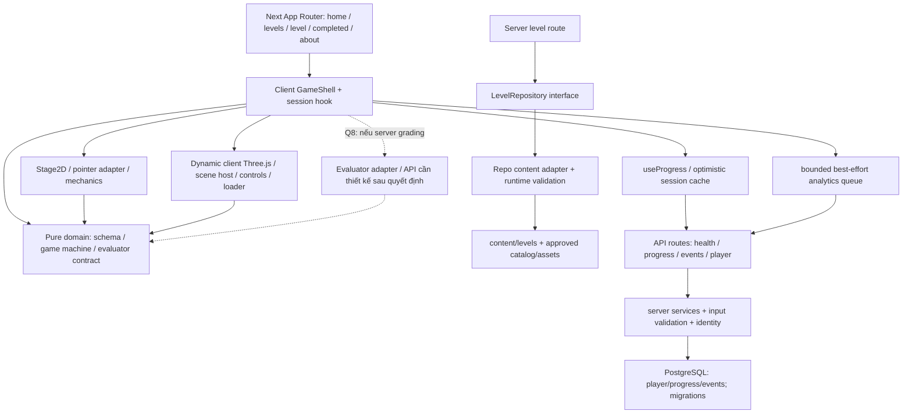
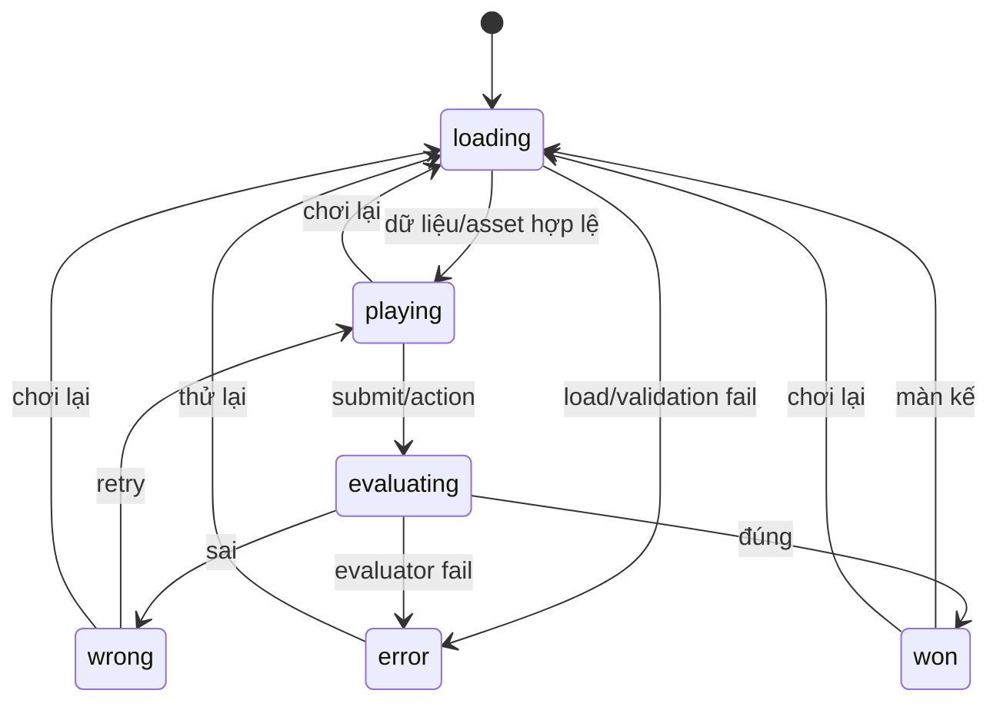

# Architecture — hiện trạng và thiết kế mục tiêu

Ngày khảo sát: **2026-11-10**, múi giờ Asia/Ho_Chi_Minh. Kế hoạch đề xuất; implementation bắt đầu 2026-11-11 với SP-00 (trạng thái hiện hành ở PROGRESS.md).

<!-- plan-stats: tasks=147; sprints=12; points=201 -->

## Hiện trạng đã xác minh

Chỉ có repository tài liệu. Chưa có app, module, route, service, hook, store, API, schema DB hay renderer để mô tả kiến trúc vận hành. Next.js/Three.js/PostgreSQL là stack trong yêu cầu, không phải dependency đã cài. Sơ đồ sau là **thiết kế đề xuất**, cần được chốt/tinh chỉnh trong task liên quan.

## Thiết kế mục tiêu

Không thêm auth server, microservices, external CMS, global state library, physics engine, WebSocket hay payments vào baseline. Nếu cần engine/ORM/library mới, ghi lý do/compatibility trong ADR và lockfile tại task sở hữu. Chỉ chọn phiên bản lúc thực thi sau khi kiểm tài liệu chính thức, không gán latest theo ngày khảo sát.

## Ranh giới module và ownership

| Module/file dự kiến | Trách nhiệm | Task sở hữu ban đầu |
|---|---|---|
| `src/app/`, layout, globals | Routing, server/client boundary, shell web | LL-001-T01, LL-004-T03, LL-023-T01 |
| `src/domain/levels/` | Schema phân biệt 2D/3D, LevelRepository contract | LL-004-T01/T02 |
| `src/server/levels/` | Adapter repo, runtime schema validation, sanitized client metadata | LL-004-T02 |
| `src/domain/game/` | Transition deterministic và async evaluator contract, không React/DB | LL-005-T01 |
| `src/features/game/` | Shell/session/registry/results/error integration | LL-004-T03, LL-005-T02/T03, LL-048 |
| `src/domain/2d/`, `src/features/2d/` | Math tọa độ, Stage2D, tap/drag/choice/text | LL-042, LL-009, LL-043 |
| `src/domain/answers/` | Chuẩn hóa Unicode/giữ-bỏ dấu/aliases | LL-043-T01 |
| `src/features/3d/` | SceneHost, picking, camera, dragging, loader/cache/disposal | LL-014, LL-015, LL-016 |
| `src/server/db/`, `db/migrations/` | DB client, migration, health probe | LL-002; bảng nghiệp vụ ở LL-007/049 |
| `src/server/progress/`, `src/features/progress/` | Cookie identity, idempotent persistence, session fallback | LL-007; xóa theo LL-051-T02 |
| `src/server/analytics/`, `src/features/analytics/` | Event schema/ingest/queries/queue | LL-049 |
| `content/levels/`, `public/assets/levels/` | Dữ liệu/asset sản phẩm đã duyệt | Task từng màn/content/model |
| `docs/content/`, `docs/assets/` | Script, catalog, reviews, license ledger | LL-028…036/044/037 |
| `tests/unit/`, `tests/integration/`, `tests/e2e/` | Domain/components, DB/API, browser flows | AI-T07/T08 + task hành vi liên quan |

Tất cả đường dẫn trên là **dự kiến**, chưa tồn tại trước planning. Feature-level state dùng hook/session reducer với state machine thuần; progress cache theo phiên; 3D local scene state. Không cần global store đến khi có bằng chứng vấn đề chia sẻ state. Source chưa xác nhận bất kỳ cách quản lý state nào.

## Routes và API đề xuất

| Route | Trạng thái lúc khảo sát | Contract/validation và lỗi |
|---|---|---|
| `/`, `/levels`, `/levels/[ordinal]` | MISSING | Catalog-derived routes, validate ordinal, missing khác invalid data, all-open policy |
| `/completed`, `/about` | MISSING | 25 valid completions mới complete; thông tin/credits và xóa dữ liệu thực |
| `/lab/2d`, `/lab/3d`, `/lab/ui` | MISSING; lab không là nội dung release | Chỉ thử rendering, lifecycle, glyph và UI states; bỏ/ẩn khỏi production public navigation |
| `GET /api/health` | MISSING | Bounded DB read/write probe, cleanup, 200/503; không lộ stack/DSN |
| `GET/POST /api/progress` | MISSING | Identity từ cookie, validate level/completion, idempotent upsert; không nhận player id tùy ý |
| `POST /api/events` | MISSING; Should | Allowlist năm events, payload limit, event-id dedupe, bounded best effort, không PII trong payload |
| `DELETE /api/player` | MISSING; cách thực thi cần Q5 | Xóa đúng cookie player/progress/events; lỗi không báo thành công giả |
| API evaluator nếu Q8 chọn server | UNKNOWN (quyết định), không tự mở rộng scope | Thiết kế endpoint/body/status/tests trước khi LL-005 được admit; tăng task nếu vượt một ngày |

## Mô hình dữ liệu đề xuất

- Catalog có id ổn định `2d-01…20`, `3d-01…05`, ordinal 1–25 do PO duyệt; không giả định ordinal 21–25 là 3D.
- Level schema có version/kind/mechanic/config/win condition; validation ở adapter và content validator. Production validator đòi đúng 25 implementation; fixture chỉ cho test/lab.
- Player/token và completion có unique `(player_id, level_id)`; migration của tiến độ tách khỏi DB health. Retention/xóa cần quyết định data; progress không bị khóa theo thứ tự mặc định.
- Events có event/session id, năm event types, level/time/player/device class, dedupe. Query phải định nghĩa mẫu số và abandon; unload không bảo đảm event giao được.
- Nội dung/đáp án trong client payload tùy grading decision. Client evaluator đơn giản hỗ trợ offline nhưng không chống xem đáp án; server-only bảo vệ đáp án tốt hơn nhưng cần giải quyết offline/latency và thêm API. Không tự chốt hai yêu cầu mâu thuẫn.

## Luồng trạng thái và lỗi

Ở mọi trạng thái có đường về chọn màn; reset/exit hủy hoặc vô hiệu response cũ. Offline banner không ngắt màn đã nạp theo grading contract; progress/events lỗi không chặn chơi. Error boundary theo màn ngăn crash lan; global error có fallback. 3D loader có retry/exit và không tạo % giả khi không biết total bytes.

## Hiệu năng và vòng đời

- Dynamic client load Three.js; selector/2D initial path không nạp bundle 3D.
- Scene unmount hủy RAF/listener và dispose ownership rõ; cache asset không double-dispose khi dùng chung. Test heap 20 vòng sau warmup theo source LL-014.
- Budget số duy nhất ở `docs/performance/3d-budget.json` do LL-016-T01 tạo và duyệt; không phát minh MB/poly/draw-call thresholds ở planning.
- Pointer adapter chuẩn hóa CSS/logic coordinates; test bốn viewport và resize/rotation.
- Prefetch màn kế hữu hạn; đo cold/warm staging 4G cùng profile/hash. Ngưỡng ≤3s/≤1MB/≤1s là tạm của LL-041, không kết quả đã đo.

## Quyết định cần ADR hoặc xác nhận

LL-001 chọn runtime/package versions; LL-002 chọn DB library/migration; LL-008 chọn DOM/SVG hay Canvas bằng số đo; LL-016 chốt budget/cache; AI-T03 chọn hosting; AI-T04 chốt data lifecycle; AI-T05 chốt grading/offline; AI-T06 chốt art. Kiến trúc điều chỉnh theo quyết định, cập nhật BACKLOG/JSON/DAG trước coding phần ảnh hưởng.
