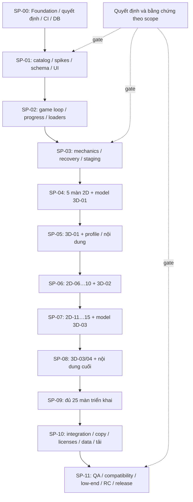
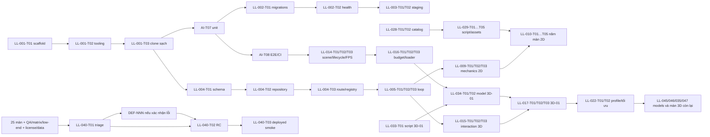

# Roadmap và Dependency Graph

Ngày khảo sát: **2026-11-10**, múi giờ Asia/Ho_Chi_Minh. Kế hoạch đề xuất; implementation bắt đầu 2026-11-11 với SP-00 (trạng thái hiện hành ở PROGRESS.md).

<!-- plan-stats: tasks=147; sprints=12; points=201 -->

## Trạng thái và milestone

Kế hoạch greenfield trên working tree được khảo sát. Không có migration từ hệ thống đang chạy. Scope đầy đủ gồm cả Should/Could; có thể cắt theo quy tắc dưới đây. Chưa gán ngày kết thúc vì Q1/Q2 chưa rõ; 16–20/11/2026 là giả định của sprint cũ, không là Sprint 0 được xác nhận.

| Sprint | Goal | SP task | Task count |
|---|---|---:|---:|
| SP-00 | Nền tảng Next.js/TypeScript, tooling/CI, PostgreSQL và quyết định có thể truy vết. | 15 | 13 |
| SP-01 | Chốt catalog, renderer 2D và rủi ro 3D; có contract nạp màn và UI tiếng Việt. | 17 | 12 |
| SP-02 | Chơi được vòng mẫu, chọn màn, sân 2D, nạp 3D và lưu/khôi phục tiến độ ẩn danh. | 18 | 12 |
| SP-03 | Hoàn thiện tương tác 2D/3D, phục hồi lỗi, responsive và staging có DB. | 17 | 13 |
| SP-04 | Giao lát cắt 2D đầu tiên gồm năm màn thật, script/model cho 3D-01. | 18 | 13 |
| SP-05 | Giao 3D-01, đo/tối ưu ba thiết bị và chuẩn bị nội dung 2D lô 2 cùng bốn script 3D. | 17 | 14 |
| SP-06 | Giao thêm năm màn 2D, 3D-02 và trang chủ Chơi tiếp. | 18 | 11 |
| SP-07 | Giao 2D-11…15, model 3D-03 và phản hồi đúng/sai hoàn chỉnh. | 18 | 13 |
| SP-08 | Giao 3D-03, 3D-04; duyệt 2D lô cuối và kiểm tra điều kiện hoàn tất. | 18 | 14 |
| SP-09 | Đủ 20 màn 2D và năm màn 3D triển khai theo script đã duyệt. | 17 | 10 |
| SP-10 | Tích hợp analytics, ghi công/xóa dữ liệu, rà văn bản và tối ưu tải toàn bộ nội dung. | 14 | 12 |
| SP-11 | Nghiệm thu 25 màn, matrix và máy yếu; đóng release gates, RC và deployed smoke. | 14 | 10 |

Các milestone là điều kiện kiểm chứng: SP-00 clone/build/CI/DB; SP-01 prototype và contract; SP-03 khung tương tác trên staging; SP-04 năm màn 2D; SP-05 một màn 3D được profile; SP-09 đủ 25 implementation; SP-10 tích hợp toàn bộ; SP-11 release có evidence. Chưa milestone nào được đánh dấu đạt.

## Dependency graph ở mức increment

Các mũi tên sau biểu diễn thứ tự increment, không thay toàn bộ DAG task. Quan hệ chính xác nằm ở `tasks.json.tasks[].dependencies`, từng task tại BACKLOG, và execution waves tại SPRINT_PLAN.

## Các chuỗi dependency kỹ thuật quan trọng

Các box gộp nhiều task chỉ tóm tắt chuỗi; không hàm ý tất cả dependency được vẽ. Ví dụ mỗi root task kế thừa terminal tasks của story phụ thuộc trong bảng backlog nguồn; JSON giữ đầy đủ và validator kiểm cả DAG lẫn lịch. Không có vòng dependency trong baseline hiện tại.

## Capacity, admission và tái lập lịch

12 Sprint là **phân bổ ứng viên có điều kiện**, tối đa 18/20 SP theo capacity tạm của tài liệu nguồn. Không mở task chỉ vì nó có sprint_id: mọi dependency phải done và gate có evidence. Trong cùng sprint, mở wave kế tiếp sau dependency thực đã đạt. Task chỉ được nhận vào scope thực thi sau dependency đã done. Nếu predecessor không kịp đạt trong sprint, dời dependent sang sprint kế và cập nhật forecast.

Không quy SP sang giờ tự động. Nếu thiếu người kiêm 3D/art/QA, task >1 ngày, script thêm mechanic, device/credential chưa có hoặc bug được xác nhận, cập nhật capacity/DAG và dời ứng viên. Q1/Q2 quyết định số tuần thực; baseline 201 SP không bao gồm khối lượng bug chưa biết. Tách từng DEF-NNN khi có repro rồi gắn vào gate RC.

## Cắt scope có kiểm soát

P3 LL-027 cắt trước; tiếp theo P2 home/feedback/copy/perf/analytics/notice theo quyết định PO. Phải xét cả hậu quả: cắt analytics thì sửa notice/deletion/schema và bỏ dependency release tương ứng; không nói thu sự kiện nếu không thu. Không bỏ attribution/privacy thực tế hoặc tiêu chí release thiết yếu chỉ vì story nguồn là Should. Không cắt Must hay số màn 25 mà không ghi thay đổi yêu cầu. Rerun validator sau mọi thay đổi.
