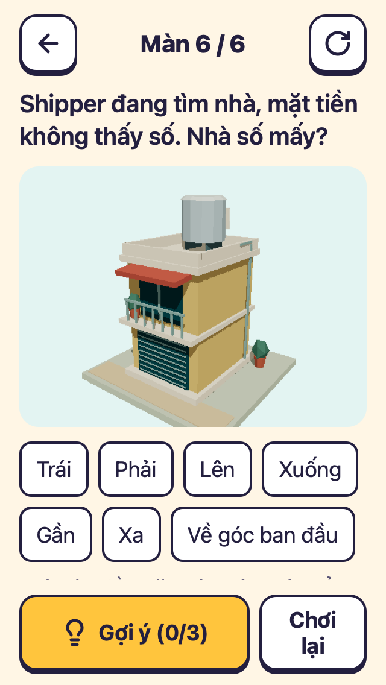
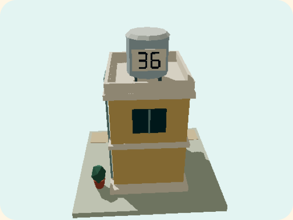

# 3D-01 — Nhà số mấy? — bằng chứng nghiệm thu

Ngày **16/11/2026**, giờ Việt Nam. Trạng thái **Chờ duyệt (`in_review`)**, chưa commit. HEAD trước thay đổi: `20d0637`, working tree sạch. Phạm vi duy nhất: màn sản phẩm **3D-01**. Đã đọc CLAUDE.md, LEVELS, HOW_TO_ADD_LEVEL, GDD/TECH, scrum và bộ máy hiện có; `verify_plan.py` đạt trước khi nhận việc.

## Phạm vi và duyệt phương án

Trình bày đề, cơ chế, cách giải và phương án dựng cảnh trước khi sửa code. Người dùng trả lời **“tiếp tục”** sau phương án; đó là xác nhận triển khai của lượt này. Không nhận các màn 3D khác, không đổi GDD/LEVELS/TECH, tài liệu gốc hoặc baseline 147 task.

- **Đề:** “Shipper đang tìm nhà, mặt tiền không thấy số. Nhà số mấy?”
- **Cơ chế:** thị giác, xoay một ngón quanh nhà, quan sát trên cao, nhập số bằng bàn phím chạm.
- **Cách giải:** đi vòng ra sau nhà, thấy **36** trên bồn nước sân thượng, nhập 36 rồi Gửi. Nhập 35 chưa thắng; nhập 63 có phản hồi riêng về đọc ngược. Thử lại không giới hạn.
- Giữ nguyên đề, tên, độ khó 2, ba gợi ý và lời giải thích trong LEVELS. Test nội dung đọc trực tiếp bảng để đối chiếu từng trường.
- **Thứ tự bản đang có:** `3d-01.ordinal=6`, hiển thị 6/6 sau năm màn 2D. Catalog yêu cầu ordinal liên tục. Vị trí #8 trong thiết kế đủ 25 màn được giữ trong hồ sơ; đổi ordinal khi có 2D-06/07, mã lưu tiến trình `3d-01` không đổi. Không dựng màn đệm.

## Cảnh, mô hình chung và tương tác

`src/levels/3d-01/` gồm meta, cảnh và CSS. Dùng SceneProps để báo tiến triển/sai/thắng; LevelShell/LevelRun giữ ba gợi ý, thời gian, chơi lại, tiến trình và bốn loại sự kiện đo lường.

| Mô hình | Cách dựng | API dùng lại |
|---|---|---|
| Townhouse | Nhà ống hai tầng, cửa cuốn, cửa sổ, ban công, mái che, lan can sân thượng và ống nước; khối hộp | `engine/stage3d/models/townhouse.tsx`, `wallColor`, `trimColor`, props group của R3F |
| WaterTank | Trụ 12 cạnh, nắp, chân hộp, nhãn ở mặt -Z; số ghép từ các nét hộp | `water-tank.tsx`, `number`, `color`, props group; `TankNumber` hỗ trợ các chữ số 0–9 |
| Planter | Chậu trụ 8 cạnh, lá đa diện 20 mặt | `planter.tsx`, `potColor`, `leafColor`, props group |
| BoxParts | InstancedMesh cho các chi tiết hộp cùng màu | `box-parts.tsx`, danh sách vị trí/kích thước/góc quay và màu |

Tất cả tự dựng bằng code; không tải mô hình, ảnh, texture hoặc phông chữ ngoài. Chi tiết song cửa, ống nước, chân bồn và nét số dùng instancing để giảm draw call. Geometry/material trong JSX do R3F sở hữu và giải phóng khi tháo cảnh; không thêm bộ nhớ đệm tài nguyên GPU cấp module.

- **Camera đầu:** `[6.7, 6.4, 9]`, nhìn về `[0, 2.7, 0]`, FOV 42°. Thấy mặt tiền, lối bên hông và bồn; thân bồn che nhãn số phía sau. Không có số nhà ở mặt tiền.
- **Manh mối:** ống nước chạy lên sân thượng ở bên hông, khoảng sân vòng nhà, câu nhắc nhìn quanh và bàn tay minh họa kéo. Không tự quay camera để lộ đáp án.
- **Giới hạn:** góc cực 47°–83°, phương vị -180°…180°, khoảng cách 9–14; không pan. Một ngón kéo xoay, hai ngón thu phóng; các nút chạm là đường thao tác thay thế đầy đủ.
- **Reset:** nút “Về góc ban đầu” của Scene3D khôi phục cả hướng và khoảng cách. Test so sánh số đo camera trước/sau, không chỉ kiểm nút có mặt.
- `canReadTankNumber` dùng `isOrbitNear`: vùng phía sau 180° ±40°, góc cực 65° ±18°. Dùng để báo tiến triển và kiểm vùng quan sát; điều kiện thắng vẫn là nhập đúng số, không buộc căn một góc hẹp.
- **NumberPad dùng chung** ở `engine/input/`: mở bằng “Nhập số nhà”, tối đa hai chữ số, có Xóa/Gửi. Rỗng không gửi, khóa sau thắng, không mở bàn phím hệ thống che cảnh. Tất cả nút có vùng chạm ≥44 px.
- **Hướng dẫn kéo dùng chung:** `Scene3D.showDragHint`, bật ở màn này, có thể bật tiếp cho 3D-02 khi dựng sau. Bàn tay mờ không chặn chạm, tính 5 giây sau khi Canvas sẵn sàng, ẩn ngay khi tương tác; CSS tắt hoạt ảnh khi giảm chuyển động.
- Tiếp tục dùng Canvas tải lười `ssr:false`, demand rendering, DPR giới hạn và InteractionQuality sẵn có. Bộ đo chỉ quan sát frame, không tạo vòng render mới.

## Số đo hiệu năng

<!-- metrics:start -->
| Cấu hình | Body sau nén | Transfer trình duyệt báo | Draw call cao nhất | Tam giác cao nhất |
|---|---|---|---|---|
| iPhone SE / WebKit | 256.246 byte | **258.646 byte** | **28** | 1.408 |
| Pixel 5 / Chromium | 255.962 byte | **258.362 byte** | **28** | 1.408 |
| 360×640 / Chromium | 255.962 byte | **258.362 byte** | **28** | 1.408 |

Đạt cả hai mục tiêu: **28 <50 draw call/frame**; lần tải 3D đầu tiên cao nhất **258.646 byte ≈0,259 MB <1 MB**, gồm HTML và gói 3D chung. JSON gốc: [iPhone SE](E4-3D-01.artifacts/iphone-se-budget.json), [Pixel 5](E4-3D-01.artifacts/pixel-5-budget.json), [360 px](E4-3D-01.artifacts/mobile-360-budget.json).
<!-- metrics:end -->

**Cách đo:** context trình duyệt mới, mở trang chủ và ghi các URL đã tải; sau đó dựng tiến trình trước màn 3D, mở 3D-01 lần đầu. Tổng byte của tài nguyên mới lấy từ Resource Timing (`encodedBodySize`, `transferSize`), **kèm document điều hướng**. Bao gồm mã riêng màn, HTML/CSS và gói Three/R3F/drei dùng chung lần đầu. Không nạp trước một màn 3D khác. Ngưỡng kiểm: `transferSize < 1.000.000 byte`; `encodedBodySize` được ghi riêng.

**Draw call:** lấy `gl.info.render.calls` sau render, tắt autoReset mặc định của Three và reset đầu frame để **tính cả lượt vẽ bóng**. Khi tháo cảnh, trả lại cấu hình và gỡ observer. Quét 108 mẫu qua 36 phương vị ở ba góc cực (71,75°, 47°, 83°); hai đầu ±180° đều quan sát được. Ngưỡng kiểm `<50 draw call/frame`. Dataset trên Canvas chứa góc, khoảng cách, draw call và tam giác, không đưa số đo vào luồng người chơi.

**Giới hạn:** số đo trên WebKit/Chromium tự động ở macOS, chưa phải FPS/độ mượt trên điện thoại thật. Ca máy yếu chủ động làm chậm requestAnimationFrame khoảng 60 ms để kiểm hạ DPR về 1 và tắt bóng; đó là kiểm hành vi tự hạ chất lượng, không phải benchmark FPS thực tế.

## Kiểm thử và kết quả

Node **22.22.3**, npm **10.9.8**, Playwright **1.65.0**. Ba cấu hình: iPhone SE/WebKit 320×568, Pixel 5/Chromium 393×727, Chromium có cảm ứng 360×640.

| Lệnh | Kết quả | Log |
|---|---|---|
| `npm run check` | Exit 0; lint, format và typecheck đạt | [01-check.txt](E4-3D-01.artifacts/01-check.txt) |
| `npm run test` | Exit 0; **239 ca / 24 file** | [02-unit.txt](E4-3D-01.artifacts/02-unit.txt) |
| `npm run test:e2e -- --workers=2` | Exit 0; **153 ca production**, gồm build | [04-e2e-production.txt](E4-3D-01.artifacts/04-e2e-production.txt) |
| `E2E_DEV=1 npm run test:e2e -- --workers=2 tests/e2e/level-3d-01.spec.ts` | Exit 0; **15 ca dev/StrictMode** | [05-3d-dev.txt](E4-3D-01.artifacts/05-3d-dev.txt) |
| `npm run test:examples` | Exit 0; **9 ca ví dụ**, tự dọn khỏi catalog | [06-examples.txt](E4-3D-01.artifacts/06-examples.txt) |
| `npm run test:e2e -- --workers=2 tests/e2e/level-3d-01.spec.ts` | Exit 0; **15 ca production**, tính cả HTML; build lại đúng sáu màn sau kiểm ví dụ | [07-3d-final-production.txt](E4-3D-01.artifacts/07-3d-final-production.txt) |
| `python3 docs/ai-planning/verify_plan.py` | Exit 0; PASS, baseline/DAG/hash không đổi | [08-verify-plan.txt](E4-3D-01.artifacts/08-verify-plan.txt) |

Sau cùng đã chạy lại `npm run check` (exit 0), `git diff --check` (exit 0), đối chiếu tổng scrum: 51 story/211 điểm, 45 chưa làm/1 đang làm/5 chờ duyệt, 29 sẵn sàng/102 điểm. Catalog chỉ còn sáu màn sản phẩm sau khi script ví dụ tự dọn.

Unit kiểm số đúng/sai/đảo ngược/rỗng, vùng quan sát bao qua ±180°, camera hỏng, bàn phím giới hạn/sửa/gửi và thời gian hướng dẫn. Các test này sử dụng đúng hàm/component mà cảnh gọi.

15 ca riêng màn 3D trên mỗi môi trường gồm 5 hành vi × 3 cấu hình:

1. Canvas dùng WebGL2 thật, góc đầu chưa ở vùng đọc số, hướng dẫn tự hết sau 5 giây; kiểm bố cục/chụp mặt tiền.
2. Kéo đổi camera; giới hạn lên/xuống/gần/xa; reset trả đúng phương vị, góc cực và khoảng cách đầu.
3. Hai số sai có phản hồi riêng, chưa mở kết quả; xoay và nhập 36 bằng **nút chạm** thì thắng; chơi lại che số ở góc đầu và vẫn giải được. Kiểm `wrongCount`, `level_complete` và giải thích.
4. Đo tải 3D lần đầu và quét draw call qua các hướng/góc cao thấp.
5. Máy chậm giả lập tự hạ DPR, giảm chuyển động tắt hoạt ảnh tay; vẫn thắng được khi đồ họa thấp.

Kịch bản giải ở `tests/e2e/solutions/3d-01.ts` chỉ dùng `tap` trên điều khiển xoay, bàn phím và Gửi. Kéo bằng chuột được kiểm riêng để xác nhận OrbitControls; không cần cảm biến/phím tắt hoặc gọi thẳng callback thắng. Luồng chiến dịch đã mở rộng từ năm lên sáu màn, kiểm đi tiếp từ 2D-05 sang 3D-01 và lưu tiến trình.

Audit DOM kiểm chữ ≥16 px, vùng đánh dấu chạm ≥44 px và không tràn ngang trên cả ba kích thước. Fixture kiểm console/cảnh báo, pageerror, mạng và luồng sự kiện; chỉ cho phép thông báo GPU ReadPixels của driver Chromium headless và cảnh báo preload CSS Next dev đã có lý do cụ thể. 153 ca gồm 15 ca cố ý gây lỗi (`test.fail`) để kiểm cổng chất lượng như trước; không phải lỗi sản phẩm còn mở.

## Ảnh render đã xem

Mỗi cấu hình có ảnh mặt tiền, mặt sau và crop Canvas mặt sau trong [screenshots/](E4-3D-01.artifacts/screenshots/). Đã xem ảnh thật: số 36 chỉ đọc được ở mặt sau bồn, không bị lật gương; ở góc đầu không đọc được số. Màn hình thấp dùng cuộn bên trong sân chơi theo khung hiện có, thanh gợi ý/chơi lại giữ nguyên vị trí.

| Mặt tiền, chưa lộ số | Mặt sau bồn nước |
|---|---|
|  |  |

## Phát hiện trong quá trình kiểm

- Sandbox chặn mở cổng 3100 (EPERM); chạy lại máy chủ/Playwright với quyền phù hợp rồi kiểm được WebGL thật. [Log lần khởi động bị chặn](E4-3D-01.artifacts/03-sandbox-start.txt).
- Phép đo đầu mở trang chủ rồi dùng fixture giữ tiến trình cũ, khiến màn 3D vẫn khóa. Đã sửa setup test: tạo lại tiến trình trước màn cần đo, không giả lập thắng. 12 ca hành vi đầu đã đạt, ba ca đo được kiểm lại và toàn bộ 153 ca đạt. [Log lần đầu](E4-3D-01.artifacts/03-3d-first-attempt.txt).
- Kiểm tra mã Three cho thấy autoReset xảy ra sau lượt bóng; đã chuyển reset về đầu frame, đo sau frame và dọn observer khi tháo cảnh.
- Bổ sung document điều hướng vào tổng byte sau lượt hồi quy đầu. Ảnh mặt sau đợi phản hồi sai tự ẩn rồi đưa Canvas vào khung, tránh tooltip hoặc vị trí cuộn che bồn nước. Chỉ bộ đo/ảnh test được tinh chỉnh sau lượt 153 ca; kiểm lại 15 ca dev và 15 ca production.

## Bàn giao

Đã cập nhật **cả bốn file scrum**: phạm vi/nguồn duyệt/thứ tự tạm ở HO_SO; LL-033/034/017 và tổng trạng thái ở BACKLOG; phạm vi riêng/nhật ký ở SPRINT; kết quả không tính velocity ở LICH_SU. Dừng ở `in_review`; chưa đặt Xong hoặc tự commit.

Còn xác minh khi có điều kiện: chơi trên điện thoại thật, đo FPS và thử độ khó với người chơi. Các số tạm của ngân sách đã đạt trên trình duyệt tự động, không thay cho xác nhận thiết bị thật của LL-014/022/050.

Đề xuất commit: **`feat: thêm màn 3D-01 Nhà số mấy`**.

Tái hiện: [reproduce.sh](E4-3D-01.artifacts/reproduce.sh). Mã thoát: [exit-codes.txt](E4-3D-01.artifacts/exit-codes.txt). Dấu vân tay mã/bằng chứng: [files.sha256](E4-3D-01.artifacts/files.sha256).
