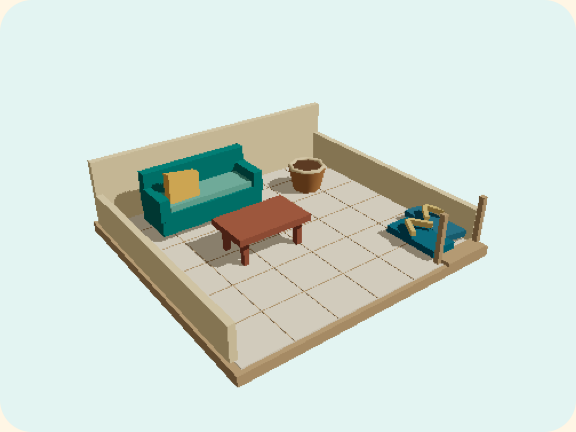
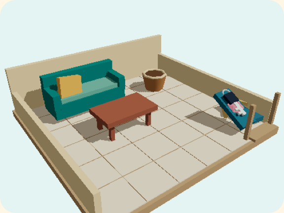

# 3D-02 — Tìm chìa khóa xe máy — bằng chứng nghiệm thu

Ngày **17/11/2026**, giờ Việt Nam. Trạng thái **Chờ duyệt (`in_review`)**, chưa commit. HEAD trước thay đổi: `dfc3fbb`, working tree sạch. Phạm vi duy nhất: màn sản phẩm **3D-02**.

## Phương án đã duyệt và phạm vi

Đã đọc CLAUDE.md, LEVELS, HOW_TO_ADD_LEVEL, GDD/TECH và cả bốn file scrum; cổng kế hoạch đạt trước khi làm. Trình bày đề, cơ chế, cách giải, vật thể, camera và tương tác trước khi viết code. Người dùng trả lời **“oke”** ngày 17/11 để duyệt phương án đó.

- **Đề:** “Sắp trễ giờ! Chìa khóa xe máy đâu rồi?”
- **Cơ chế:** Vật lý · Xoay + chạm, độ khó 3.
- **Cách giải:** khám phá phòng, chạm một trong hai chiếc dép ở cửa để lật chiếc có chìa; chạm chìa khóa dính kẹo cao su dưới đế. Chỉ xoay hoặc lật dép chưa thắng. Gối sofa, giỏ và bàn có ba câu phản hồi sai riêng; thử không giới hạn.
- Giữ nguyên tên, đề, ba gợi ý, lời giải thích và độ khó trong LEVELS; unit test đọc bảng để đối chiếu.
- `3d-02.ordinal=7` trong catalog bảy màn hiện có để giữ thứ tự liên tục; vị trí thiết kế vẫn #13 khi đủ các màn 2D xen kẽ. Mã lưu tiến trình luôn là `3d-02`.
- Không dựng màn đệm hoặc màn 3D khác; không đổi GDD/LEVELS/TECH, tài liệu gốc hoặc baseline 147 task.

## Mô hình và bộ máy

Tất cả là low-poly dựng bằng code, không mô hình/ảnh/texture tải ngoài, không thêm dependency. Tài nguyên GPU trong JSX do R3F giải phóng khi tháo cảnh; không thêm cache GPU cấp module.

| Thành phần dùng chung | Nội dung / API |
|---|---|
| `models/townhouse-room.tsx` — TownhouseRoom | Phòng nhà ống cắt mở, nền gạch, tường thấp và ngưỡng cửa; đổi `wallColor`, dùng props group |
| `models/sofa.tsx` — Sofa, Cushion | Khung/đệm sofa và gối rời; đổi màu, đặt tư thế bằng props group |
| `models/low-table.tsx` — LowTable | Mặt và bốn chân hộp; đổi màu |
| `models/basket.tsx` — Basket | Trụ 8 cạnh, miệng vòng và lòng giỏ |
| `models/slipper.tsx` — Slipper | Đế hộp, hai quai; gắn vật dưới -Y, xoay nhóm để lật |
| `models/motorbike-key.tsx` — MotorbikeKey | Đầu nhựa, thân/răng kim loại và khoen 10 cạnh |
| `tap-target-3d.tsx` — TapTarget3D | Vùng chạm luôn ≥44 px theo khoảng cách/FOV, hướng về camera, kiểm vật che bằng raycast; bỏ click nếu đã kéo >6 px |

Các chi tiết hộp cùng vật liệu dùng lại `BoxParts`/InstancedMesh. Hộp chạm không vẽ vào framebuffer nên không thêm draw call. Tọa độ vùng chạm trên Canvas chỉ phục vụ chẩn đoán; E2E phải tạo thao tác chạm thật để đi qua raycast và luật chơi, không gọi thẳng callback thắng.

**Camera đầu:** `[-6.8, 7, 9.2]`, nhìn về `[0, 0.5, 0.15]`, FOV 40°. Nhìn chéo trước-trái, thấy phòng và đôi dép nằm lệch ở cửa; chìa nằm dưới đế, không đọc được ở góc đầu. Manh mối là vị trí dép ở ngưỡng cửa, bàn tay kéo và câu nhắc “Kéo để nhìn quanh, chạm đồ vật để tìm.”

**Giới hạn:** phương vị -75°…75°, góc cực 35°…76°, khoảng cách 9…14, không pan. Khi lật, dép nâng lên và nghiêng đế về phía người chơi. Chìa nhận chạm khi đã lật, ở vùng nhìn rộng do `canSeeSlipperSole`/`isOrbitNear` kiểm và không bị đồ vật khác che. Không yêu cầu căn một góc hẹp.

Scene3D có sẵn reset, nút xoay/zoom bằng chạm, Canvas tải lười `ssr:false`, demand rendering và tự hạ DPR/tắt bóng. Reset chỉ khôi phục camera; Chơi lại dựng lại toàn bộ câu đố. `showDragHint` bật ở 3D-02, là màn 3D thứ hai; 3D-01 đã bật từ trước. Bàn tay mờ tự hết sau 5 giây kể từ Canvas sẵn sàng, ẩn khi tương tác và tắt hoạt ảnh khi giảm chuyển động.

`domain/puzzles/motorbike-key.ts` chứa máy trạng thái thuần `searching → flipped → solved`; sau thắng không quay lại hoặc phát thêm lỗi. Cảnh chỉ dùng callback SceneProps, để LevelShell/LevelRun quản lý gợi ý, thời gian, tiến trình và sự kiện chung.

## Số đo hiệu năng

| Cấu hình | Body sau nén | Transfer | Draw call cao nhất | Tam giác cao nhất |
|---|---:|---:|---:|---:|
| iPhone SE / WebKit | 255.710 byte | **258.110 byte** | **29** | 956 |
| Pixel 5 / Chromium | 255.426 byte | **257.826 byte** | **29** | 956 |
| 360×640 / Chromium | 255.426 byte | **257.826 byte** | **29** | 956 |

Đạt mục tiêu **29 <50 draw call/frame** và **258.110 byte ≈0,258 MB <1 MB** tải thêm lần mở 3D đầu tiên. JSON gốc: [iPhone SE](E4-3D-02.artifacts/iphone-se-budget.json), [Pixel 5](E4-3D-02.artifacts/pixel-5-budget.json), [360 px](E4-3D-02.artifacts/mobile-360-budget.json).

**Cách đo tải:** context mới, mở trang chủ rồi ghi các URL đã tải; mở thẳng 3D-02 lần đầu, không nạp 3D-01 trước đó. Resource Timing ghi `encodedBodySize` và `transferSize` của tài nguyên mới, kèm document điều hướng. Tổng gồm mã riêng màn, HTML/CSS và Three/R3F/drei dùng chung. Ngưỡng kiểm `transferSize <1.000.000 byte` áp trên build production.

**Cách đo lệnh vẽ:** dùng bộ đo renderer sẵn có, reset đầu frame và đọc sau frame nên gồm cả lượt bóng. Mỗi cấu hình có 96 mẫu: hai trạng thái chưa lật/đã lật × ba độ cao camera × 16 phương vị từ -75° đến 75°. Ngưỡng kiểm `<50`.

**Giới hạn:** chạy WebKit/Chromium tự động trên macOS, chưa đo FPS hoặc độ mượt trên điện thoại thật. Ca máy chậm làm chậm requestAnimationFrame xuống khoảng 60 ms để kiểm hành vi tự hạ chất lượng; đó không phải benchmark FPS thiết bị thật.

## Kiểm thử

Node 22.22.3, npm theo packageManager, Playwright 1.65.0. Ba cấu hình có cảm ứng: iPhone SE/WebKit 320×568, Pixel 5/Chromium 393×727 và Chromium 360×640.

| Lệnh | Kết quả / log |
|---|---|
| `npm run check` | Exit 0; lint/format/typecheck đạt, [01-check.txt](E4-3D-02.artifacts/01-check.txt) |
| `npm run test` | **247 ca, 25 file đạt**, [02-unit.txt](E4-3D-02.artifacts/02-unit.txt) |
| Playwright riêng 3D-02 lần đầu | **12 ca đạt**, [04-3d-production.txt](E4-3D-02.artifacts/04-3d-production.txt) |
| Playwright riêng sau chỉnh hình/vùng chạm | **18 ca đạt**, [05-3d-refined.txt](E4-3D-02.artifacts/05-3d-refined.txt) |
| `npm run test:e2e -- --workers=2` | **171 ca production đạt**, gồm build, [06-e2e-production.txt](E4-3D-02.artifacts/06-e2e-production.txt) |
| `E2E_DEV=1 npm run test:e2e -- --workers=2 tests/e2e/level-3d-02.spec.ts --grep 'tải WebGL\|ba chỗ sai'` | **6 ca dev/StrictMode đạt**, [08-3d-dev-final.txt](E4-3D-02.artifacts/08-3d-dev-final.txt) |
| `npm run check` lần cuối | Exit 0; [09-check-final.txt](E4-3D-02.artifacts/09-check-final.txt) |
| `python3 docs/ai-planning/verify_plan.py` | PASS, baseline/DAG/hash không đổi; [10-verify-plan.txt](E4-3D-02.artifacts/10-verify-plan.txt) |
| `git diff --check` | Exit 0; [11-diff-check.txt](E4-3D-02.artifacts/11-diff-check.txt) |

Unit kiểm chưa lật không thể lấy chìa, lật chưa thắng, đế bị khuất chưa thắng, nhặt đúng mới thắng, ba chỗ sai giữ tiến triển, trạng thái sau thắng và camera không hợp lệ. Test nội dung đối chiếu dòng 3D-02 trong LEVELS.

Sáu hành vi E2E riêng màn × ba cấu hình:

1. WebGL2 thật, góc đầu giấu chìa, hướng dẫn tự hết sau 5 giây; bố cục và ảnh.
2. Kéo bắt đầu trên dép đổi camera mà không lật; giới hạn góc/zoom; reset khôi phục phương vị, góc cực và khoảng cách ban đầu.
3. Chạm gối/giỏ/bàn có phản hồi riêng, chưa thắng; lật dép chưa thắng; reset giữ bước đã tìm; chạm chìa mới thắng. Chơi lại che chìa và giải được lần nữa, kiểm `wrongCount`/`level_complete`.
4. Chạm lệch tâm ±20 px theo bốn hướng vẫn chọn được bàn ở cả khoảng gần và xa; kiểm đủ tám thao tác được ghi nhận.
5. Giảm chuyển động tắt hoạt ảnh tay; máy chậm tự hạ DPR về 1, vẫn giải được bằng chạm.
6. Đo tải 3D đầu tiên và draw call qua hai trạng thái/ba độ cao camera.

Kịch bản giải `tests/e2e/solutions/3d-02.ts` chỉ dùng nút xoay và `touchscreen.tap` vào Canvas thật. Luồng chiến dịch đã thêm 3D-02 sau 3D-01, kiểm Màn tiếp, thắng màn cuối và tiến trình sau tải lại. Fixture chung kiểm console/pageerror/mạng và tính hợp lệ của sự kiện; không có lỗi sản phẩm còn mở. Bộ 171 ca gồm 15 ca `test.fail` cố ý gây lỗi để kiểm cổng chất lượng, giống bộ hồi quy trước.

## Ảnh đã xem và phát hiện

| Góc đầu | Đế dép sau khi lật, có thu gần bằng nút chạm |
|---|---|
|  |  |

Ảnh đủ ba cấu hình trong [screenshots/](E4-3D-02.artifacts/screenshots/). Kiểm chữ ≥16 px, không tràn ngang và các nút DOM ≥44 px; vùng chạm Canvas có kiểm chạm lệch tâm riêng.

- Lần mở máy chủ trong sandbox bị `listen EPERM` ở cổng 3100; chạy lại với quyền phù hợp rồi kiểm được WebGL thật. [Log](E4-3D-02.artifacts/03-3d-first.txt).
- Qua ảnh lần đầu phát hiện mặt nền và đế mô hình phòng cùng cao độ gây sọc; hạ mặt đế để loại bề mặt chồng nhau. Chỉnh tư thế lật và kích thước khoen để chìa rõ hơn, nằm gọn dưới dép. Đã kiểm lại 18 ca riêng rồi toàn bộ hồi quy.
- Công cụ browser tích hợp không có công cụ thực thi trong phiên này; dùng bộ Playwright của repo theo yêu cầu, xem PNG render thực bằng công cụ xem ảnh.
- Thông báo driver Chromium headless `GPU stall due to ReadPixels` chỉ được cho phép khi chụp framebuffer, theo cách kiểm 3D-01 hiện có; không bỏ qua lỗi ứng dụng.
- Lượt dev đầu có sáu ca bị fixture chặn vì cảnh báo preload CSS UI của Next, trong khi các assertion hành vi đều qua; [log đầu](E4-3D-02.artifacts/07-3d-dev.txt). Dùng đúng ngoại lệ dev theo đường dẫn CSS đã có ở spec 3D-01, ghi lý do tại beforeEach; không sửa fixture chung hoặc ngoại lệ production. Chạy lại cả sáu ca đạt ở log 08.

## Bàn giao

Cập nhật đủ bốn file scrum: HO_SO ghi nguồn “oke”/phạm vi/thứ tự tạm; BACKLOG ghi LL-045/018 Chờ duyệt và LL-044 Đang làm một phần; SPRINT/LICH_SU ghi kết quả riêng, không cộng velocity. Tổng vẫn 51 story/211 điểm; 42 chưa làm, 2 đang làm, 7 chờ duyệt, 0 Xong; 31 story sẵn sàng/113 điểm. Baseline 147 task giữ nguyên.

Còn kiểm trên điện thoại thật và thử độ khó với người chơi; số đo hiện tại không thay cho nghiệm thu thiết bị thật của các story tối ưu chung. Chỉ bàn giao 3D-02, chưa tự đặt Xong hoặc commit.

Commit đề xuất: **`feat: thêm màn 3D-02 Tìm chìa khóa xe máy`**.

Tái hiện: [reproduce.sh](E4-3D-02.artifacts/reproduce.sh). Mã thoát: [exit-codes.txt](E4-3D-02.artifacts/exit-codes.txt). Dấu vân tay: [files.sha256](E4-3D-02.artifacts/files.sha256).
