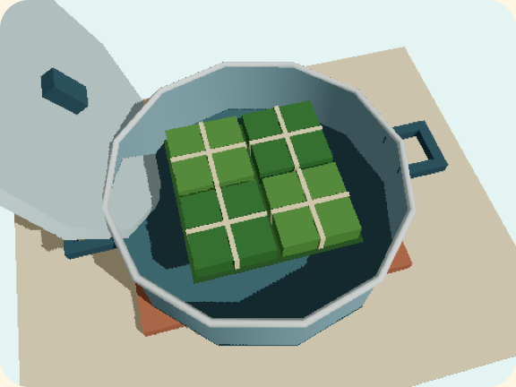
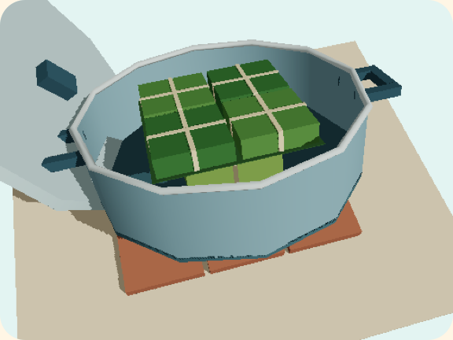

# 3D-03 — Nồi bánh chưng có mấy cái? — bằng chứng nghiệm thu

Ngày **17/11/2026**, giờ Việt Nam. Phạm vi duy nhất: **3D-03**, trạng thái bàn giao **Chờ duyệt (`in_review`)**, chưa tự commit. HEAD trước lượt này: `dfc3fbb`; working tree đã có phần 3D-02 của lượt trước và được giữ lại.

## Phương án và nguồn duyệt

Đã đọc CLAUDE.md, LEVELS, HOW_TO_ADD_LEVEL, GDD/TECH, scrum và bộ máy hiện có; cổng kế hoạch đạt trước khi làm. Trình bày đề, cơ chế, lời giải, mô hình/camera/tương tác; người dùng trả lời **“oke”** để duyệt triển khai riêng màn tiếp theo.

- **Đề:** “Nồi bánh chưng ngày Tết. Trong nồi có mấy cái bánh?”
- **Cơ chế:** Đọc kỹ đề · Xoay + kéo, rồi nhập số; độ khó 3.
- **Lời giải:** chạm nắp để mở, nhìn từ trên thấy bốn bánh. Kéo nồi để nghiêng, thấy bánh thứ năm ở tầng dưới. Nhập **5** để thắng. Nhập 4 báo **“Nhìn kỹ lại tầng dưới”**; số khác có phản hồi riêng.
- Thắng dựa vào đáp án số, không buộc giữ camera hoặc nghiêng trong một góc hẹp. Rỗng không tính sai, thử lại không giới hạn. Ba gợi ý và lời giải thích giữ nguyên LEVELS; có unit đối chiếu trực tiếp dòng tài liệu.
- Catalog hiện có tám màn nên `3d-03.ordinal=8`; vị trí thiết kế trong bộ 25 vẫn #17. Mã tiến trình ổn định là `3d-03`. Không thêm các màn đệm, 3D-04 hoặc 3D-05.
- GDD/LEVELS/TECH, tài liệu gốc và baseline 147 task không thay đổi.

## Mô hình và tương tác

| Thành phần dùng chung | Cách dựng / API |
|---|---|
| `models/cooking-pot.tsx` — CookingPot | Thành trụ mở 12 cạnh, đáy trụ, viền vòng, hai quai hộp instancing; `color` và props group |
| Cùng file — PotLid | Nắp trụ 12 cạnh và núm hộp; tách rời để đặt tư thế đóng/mở |
| `models/banh-chung.tsx` — BanhChung | Thân hộp vuông và hai vòng lạt thật; `width`, `height`, `color`, `receiveShadow`, props group |
| `models/brick-base.tsx` — BrickBase | Bệ ba viên gạch dùng BoxParts/InstancedMesh |
| `drag-object-3d.tsx` — DragObject3D | Kéo qua mặt phẳng vuông góc camera, pointer capture, khóa OrbitControls; khôi phục khi thả/hủy/mất capture/tab ẩn/blur/tháo cảnh |
| NumberPad | Thêm `valueLabel` để dùng “Số bánh”, giữ mặc định “Số nhà” cho 3D-01; một chữ số hiển thị một dấu trống |

Không dùng mô hình, texture, ảnh ngoài hoặc dependency mới. Toàn bộ tài nguyên GPU nằm trong JSX và do R3F giải phóng khi tháo cảnh; các Vector3/Raycaster phục vụ toán học không giữ GPU. Dùng lại Scene3D, TapTarget3D, BoxParts, bàn phím số và callback SceneProps. Các vùng chọn nắp/quai có kích thước tối thiểu 44 px theo camera.

**Camera đầu:** `[-0.9, 7.1, 3.4]`, nhìn `[0, 0.85, 0]`, FOV 42°; cao khoảng 61°, hơi lệch trái. Nắp phủ miệng nồi nên không thấy bánh. Sau mở nắp, bốn bánh tầng trên và lá lót che bánh đáy. Bánh thứ năm luôn được dựng từ đầu; không bật/tắt, đổi opacity hoặc sinh bánh theo trạng thái.

Nắp có núm, hai quai rõ, dòng nhắc chạm đồ vật/kéo nền giúp khám phá. Bốn bánh có khe và màu lá xen kẽ để phân biệt từng chiếc. Lá lót rất mỏng giữa hai tầng giữ khe nhìn có nền thật; nghiêng nồi nhìn thấy cạnh, thân và lạt của bánh dưới.

**Giới hạn:** phương vị -30°…30°, góc cực 25°…31°, khoảng cách 6,5…9. Nồi nghiêng 0°…24°, nâng vừa đủ khi nghiêng để không xuyên nền; cả bánh và nồi biến đổi trong cùng group. Reset chỉ phục hồi camera; “Đặt nồi thẳng” phục hồi tư thế nồi, còn Chơi lại đóng nắp và đặt lại toàn bộ.

Kéo nền xoay camera; kéo thân/quai nghiêng nồi và tạm khóa camera. Chạm quai để chọn, rồi dùng “Nghiêng nồi”/“Đặt nồi thẳng” là đường chạm thay đầy đủ. `isLookingIntoLowerLayer` đổi camera về hệ trục nồi rồi gọi `isOrbitNear` dùng chung; báo vùng quan sát, không khóa chấm đáp án.

`ObserveCakes` raycast các điểm trên mặt bánh vào hình học thật để ghi `data-visible-cakes`/`data-bottom-visible` trên Canvas. Nó không điều khiển render hoặc thắng. E2E kiểm được 0 → 4 → 5 bánh theo thực tế vật che, đồng thời vẫn phải chạm/kéo/nhập trên giao diện thật.

Scene3D giữ tải lười `ssr:false`, demand rendering, giới hạn camera, reset và tự hạ DPR/tắt bóng. Bàn tay mờ vẫn bật ở 3D-01/02; đây là màn thứ ba nên dùng manh mối trên vật thể. Không có vòng render riêng; một callback requestAnimationFrame khi mất capture chỉ trì hoãn việc hủy một lần để nhường pointerup, không tạo vòng lặp.

## Số đo hiệu năng

<!-- metrics:start -->
| Cấu hình | Body sau nén | Transfer | Draw call cao nhất | Tam giác cao nhất |
|---|---:|---:|---:|---:|
| iPhone SE / WebKit | 258.085 byte | **260.485 byte** | **34** | 912 |
| Pixel 5 / Chromium | 257.784 byte | **260.184 byte** | **34** | 912 |
| 360×640 / Chromium | 257.784 byte | **260.184 byte** | **34** | 912 |

Đạt cả hai mục tiêu: **34 <50 draw call/frame**, tải thêm cao nhất **260.485 byte ≈0,260 MB <1 MB**, gồm gói 3D chung.

JSON gốc: [iPhone SE](E4-3D-03.artifacts/iphone-se-budget.json), [Pixel 5](E4-3D-03.artifacts/pixel-5-budget.json), [360 px](E4-3D-03.artifacts/mobile-360-budget.json).
<!-- metrics:end -->

**Cách đo tải:** context mới mở trang chủ, ghi các URL đã tải, rồi mở thẳng 3D-03 lần đầu. Không nạp màn 3D khác trước đó. Resource Timing cộng `transferSize` và `encodedBodySize` của tài nguyên mới cùng document điều hướng, bao gồm mã riêng màn, HTML/CSS và Three/R3F/drei dùng chung. Ngưỡng production `<1.000.000 byte`.

**Cách đo lệnh vẽ:** bộ đo chung reset đầu frame và đọc sau frame để gồm cả lượt bóng. `data-render-view` ghi góc/khoảng cách của frame vừa vẽ; test chờ nó khớp góc yêu cầu rồi mới đọc thống kê, không chờ một RAF riêng khi cảnh đứng yên. Có 126 mẫu/cấu hình: ba trạng thái đóng nắp/mở nắp/thật sự nghiêng × ba độ cao camera × hai khoảng cách × bảy phương vị. Ngưỡng `<50 draw call/frame`. Khi nồi đứng thẳng và nắp mở, đồng thời kiểm bánh đáy tiếp tục bị che ở các góc/zoom trong giới hạn.

Số đo từ WebKit/Chromium tự động trên macOS; chưa đo FPS/độ mượt trên điện thoại thật. Ca làm chậm requestAnimationFrame khoảng 60 ms dùng để kiểm hành vi tự hạ đồ họa và vẫn giải được, không phải benchmark FPS máy thật.

## Kiểm thử

Node 22.22.3, Playwright 1.65.0. iPhone SE/WebKit 320×568, Pixel 5/Chromium 393×727 và Chromium cảm ứng 360×640.

| Lệnh / giai đoạn | Kết quả |
|---|---|
| `npm run check` | Exit 0, [01-check.txt](E4-3D-03.artifacts/01-check.txt) |
| `npm run test` lần đầu | 254 ca/26 file đạt, [02-unit.txt](E4-3D-03.artifacts/02-unit.txt) |
| Playwright ba hành vi đầu | 8 đạt/1 lỗi đọc vị trí chạm trong test helper, [03-3d-first.txt](E4-3D-03.artifacts/03-3d-first.txt) |
| Kiểm lại sau chỉnh ảnh/helper | 9 ca production đạt, [04-3d-refined.txt](E4-3D-03.artifacts/04-3d-refined.txt) |
| Dev/StrictMode: hình học, kéo/hủy và giải/chơi lại | 9 ca đạt, [05-3d-dev.txt](E4-3D-03.artifacts/05-3d-dev.txt) |
| Kiểm mã cuối | Exit 0, [06-check-final.txt](E4-3D-03.artifacts/06-check-final.txt) |
| Unit cuối | 254 ca/26 file đạt, [07-unit-final.txt](E4-3D-03.artifacts/07-unit-final.txt) |
| Hồi quy đầu | 183 đạt, 3 ca quét phát hiện lạt bánh dưới nhô khỏi lá lót; [08-e2e-production.txt](E4-3D-03.artifacts/08-e2e-production.txt) |
| Kiểm lại quét iPhone sau sửa lá lót | 1 ca đạt/126 mẫu; [09-budget-recheck.txt](E4-3D-03.artifacts/09-budget-recheck.txt) |
| Hồi quy tiếp theo | 174 đạt, 12 timeout (gồm cả màn cũ); [10-e2e-final-production.txt](E4-3D-03.artifacts/10-e2e-final-production.txt) |
| Chạy lại nhóm timeout, một worker | 11/12 đạt; ca cuối kẹt trong promise đợi requestAnimationFrame của test; [11-timeout-recheck.txt](E4-3D-03.artifacts/11-timeout-recheck.txt) |
| Kiểm riêng sau đổi cách chờ frame | 15 ca production đạt trên cả ba cấu hình; [12-3d-final-production.txt](E4-3D-03.artifacts/12-3d-final-production.txt) |
| `npm run check` sau bổ sung bộ đo frame | Exit 0; [13-check-end.txt](E4-3D-03.artifacts/13-check-end.txt) |
| `npm run test` sau bổ sung bộ đo frame | 254 ca/26 file đạt; [14-unit-end.txt](E4-3D-03.artifacts/14-unit-end.txt) |
| Hồi quy cuối, một worker | **185/186 ca đạt**; một ca máy chậm Pixel 5 của 3D-02 không đạt ngưỡng hạ đồ họa trong lượt này. Toàn bộ 15 ca 3D-03 đạt. [15-e2e-end.txt](E4-3D-03.artifacts/15-e2e-end.txt) |
| Chạy lại riêng ca 3D-02 còn lại | **1 ca đạt**, không đổi mã hoặc ngưỡng; [18-quality-recheck.txt](E4-3D-03.artifacts/18-quality-recheck.txt) |
| Cổng kế hoạch / kiểm diff | PASS/exit 0; [16-verify-plan.txt](E4-3D-03.artifacts/16-verify-plan.txt), [17-diff-check.txt](E4-3D-03.artifacts/17-diff-check.txt) |

**Tổng kết kiểm chứng:** 254 unit/component, 9 ca dev/StrictMode và toàn bộ 15 ca production của 3D-03 đạt. Cả 186 ca hồi quy đã có kết quả đạt sau kiểm lại một ca 3D-02. Lệnh hồi quy cuối nguyên lượt trả exit 1 vì ca cũ đó; lệnh `--last-failed` tiếp theo trả exit 0. Không coi lượt 185/186 là một lượt full pass. Ca giả lập máy chậm cũ có dao động theo lịch frame; cần ổn định driver nếu còn tái diễn ở CI.

Unit kiểm 5 đúng, 4 là lỗi đếm tầng trên, các số sai/rỗng, giới hạn nghiêng và dữ liệu không hữu hạn, vùng nhìn sau khi đổi hệ trục và camera hỏng. Unit NumberPad kiểm nhãn “Số bánh”, nhập một chữ số và giữ hợp đồng cũ; nội dung 3D-03 đối chiếu với LEVELS.

Năm hành vi E2E × ba cấu hình:

1. WebGL2 thật, đóng nắp không thấy bánh; mở nắp chỉ thấy bốn; nghiêng thấy đủ năm; ảnh và bố cục.
2. Kéo nồi giữ nguyên camera; hủy kéo trả tư thế trước và mở khóa camera; kéo lần nữa, xoay nền và reset camera đúng. Đặt thẳng che lại bánh đáy.
3. Nhập 4 và 6 có phản hồi riêng, chưa thắng; chọn quai/nghiêng/nhập 5 thắng chỉ bằng chạm. Chơi lại đóng nắp, đặt nồi thẳng và giải được lần nữa; kiểm đúng một kết thúc mỗi lượt và `wrongCount`.
4. Máy chậm tự hạ DPR về 1; mở nắp vẫn giấu bánh dưới, nghiêng/nhập vẫn giải được ở chất lượng thấp.
5. Đo tải/draw call, giới hạn phương vị/góc cực/khoảng cách; bánh dưới không lộ khi nồi còn thẳng ở các góc/zoom đã quét.

Luồng chiến dịch nối 3D-02 → 3D-03, kiểm thắng màn cuối và tiến trình sau tải lại. Fixture kiểm console/pageerror/mạng và sự kiện dùng chung. Chỉ giữ ngoại lệ driver Chromium headless ReadPixels khi chụp Canvas và cảnh báo preload CSS UI của Next dev đã có ở hai màn 3D trước; không bỏ qua lỗi ứng dụng. Bộ hồi quy có 15 ca `test.fail` cố ý gây lỗi để kiểm cổng chất lượng, như các lần bàn giao trước.

## Ảnh render và phát hiện

| Mở nắp: bốn bánh | Nghiêng: bánh dưới lộ thân và lạt |
|---|---|
|  |  |

Ảnh đóng nắp và toàn màn ở cả ba cấu hình trong [screenshots/](E4-3D-03.artifacts/screenshots/). Bố cục được kiểm chữ ≥16 px, không tràn ngang và nút ≥44 px; nắp/quai dùng vùng chạm chung theo camera.

- Thành nồi DoubleSide có sọc do nhận bóng của chính thành mỏng; giữ castShadow và bỏ receiveShadow trên thành. Bánh dưới nhận ánh sáng rõ hơn để nhìn ra thân/lạt. Thêm khe giữa bốn bánh và lá lót mỏng để tách từng chiếc mà vẫn che tầng dưới bằng hình học thật.
- Đọc mã R3F 9 tại local cho thấy pointercancel/lostpointercapture không được chuyển tới mesh. DragObject3D nghe sự kiện Canvas thật, trì hoãn xử lý mất capture một frame để pointerup kết thúc bình thường, và dọn listener/callback khi tháo cảnh.
- Một ca iPhone SE đầu gặp race trong helper: attribute vị trí chạm vừa được kiểm thì bị gỡ trong cập nhật frame. Sửa helper lấy và giữ nguyên giá trị trong lần poll thành công, rồi mới tạo thao tác chạm; không sửa luật chơi hoặc gọi thẳng callback. Đã kiểm lại cả ba cấu hình.
- Quét camera/zoom phát hiện mặt trên lạt của bánh đáy cao hơn lá lót một chút. Nâng lá lót tới Y=0,8 và bốn bánh tới Y=0,955 để che cả phần lạt, giữ năm bánh cố định. Quét lại xác nhận ở 126 mẫu iPhone SE trước khi chạy hồi quy tiếp.
- Có lượt chạy kéo dài bất thường và timeout trên cả màn cũ; ghi nguyên log, không tăng timeout. Sau chạy lại, ca đo còn lại dừng ở promise requestAnimationFrame trong test. Bổ sung góc frame vào bộ đo chung sau render, đổi test sang đối chiếu frame thật. Lượt kiểm riêng cuối và hồi quy cuối được ghi riêng bên dưới.
- Lượt cuối còn một ca đồ họa thấp 3D-02/Pixel 5 không hạ trong chuỗi thao tác giả lập cố định; chạy lại riêng ca đó đạt sau 5 giây, không thay ứng dụng/test hoặc nới ngưỡng. Ghi như dao động của kiểm thử cũ, không che lỗi hoặc gộp thành lượt full pass.

## Bàn giao

Phạm vi chỉ 3D-03. LL-046 (mô hình bằng code) và LL-019 (màn chơi) bàn giao Chờ duyệt; LL-044 mới có hai kịch bản 3D-02/03, còn 3D-04/05. Cập nhật đủ bốn file scrum và giữ nguyên điểm/cam kết sprint, không tính velocity. Không tự đặt Xong hoặc commit.

Đã đối chiếu tổng scrum: 51 story/211 điểm; 40 chưa làm, 2 đang làm, 9 chờ duyệt, 0 Xong; 33 story sẵn sàng/123 điểm. Giữ nguyên baseline 147 task.

Commit đề xuất: **`feat: thêm màn 3D-03 Nồi bánh chưng`**.

Tái hiện: [reproduce.sh](E4-3D-03.artifacts/reproduce.sh). Mã thoát: [exit-codes.txt](E4-3D-03.artifacts/exit-codes.txt). Dấu vân tay: [files.sha256](E4-3D-03.artifacts/files.sha256).
